# The Ides of March: Storyboard v1

91 shots, sketch frames in img/.

## Act 0 · Cold Open (15 MARCH 44 BC)

### 0.1 · 9.0s
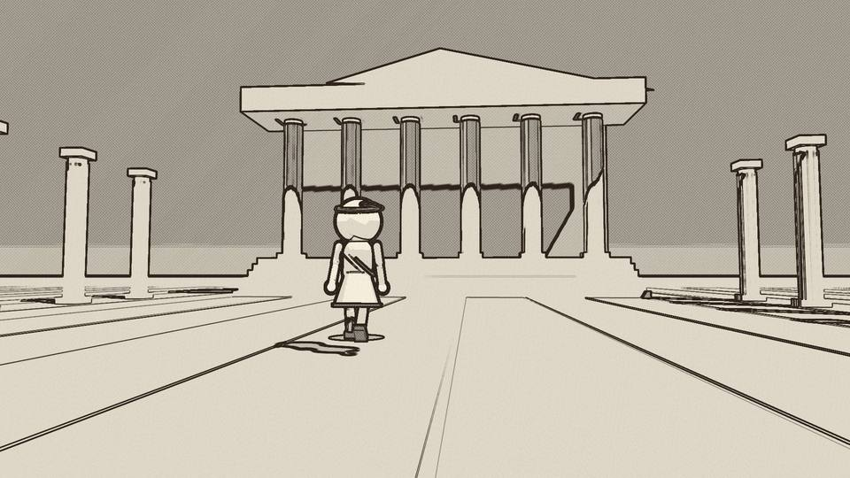

> Rome, the fifteenth of March, 44 BC. The most powerful man in the world walks into a meeting of the Senate.

- **Frame:** Caesar in a purple-bordered toga walks up marble steps into the Curia of Pompey, morning light
- **Motion:** low angle tracking behind him up the steps
- **Sound:** footsteps on marble, distant crowd
- **On-screen text:** 15 MARCH 44 BC

### 0.2 · 4.2s
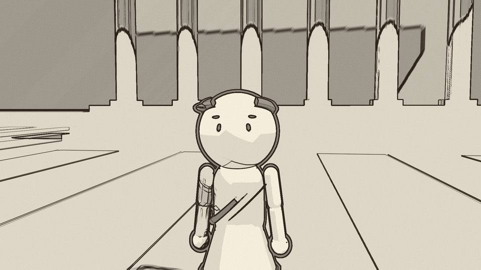

> His name is Gaius Julius Caesar. Dictator for life.

- **Frame:** Caesar's face, calm brows, laurel wreath; name callout
- **Motion:** slow push in
- **Sound:** deep drum hit
- **On-screen text:** callout: GAIUS JULIUS CAESAR / DICTATOR FOR LIFE

### 0.3 · 7.0s
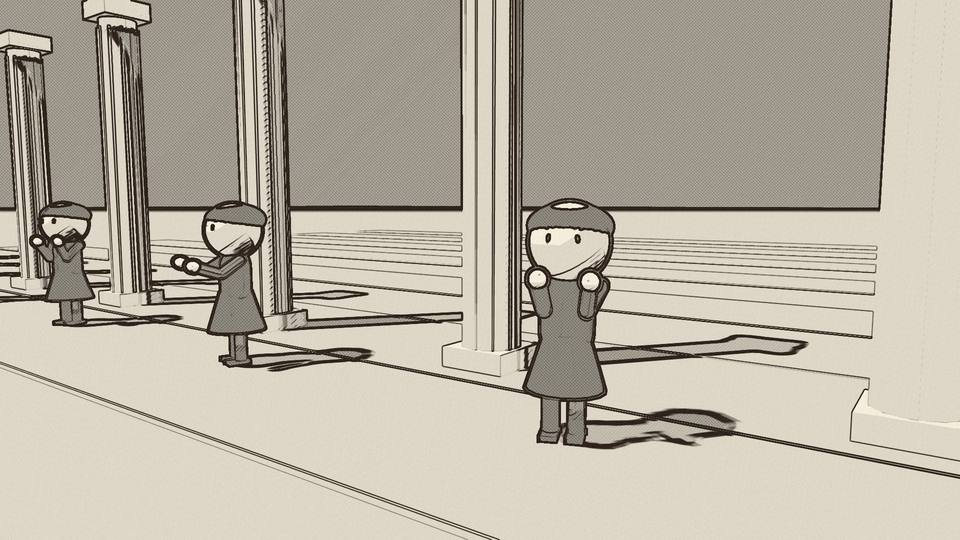

> Outside the door, a group of gladiators waits in the courtyard, trying not to be noticed.

- **Frame:** Gladiators loitering among columns, helmets under arms
- **Motion:** lateral dolly along the colonnade
- **Sound:** armour clinks, low murmur

### 0.4 · 8.6s
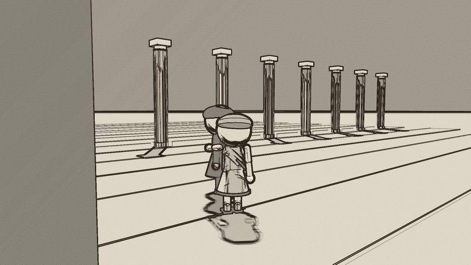

> His closest ally, Mark Antony, should be at his side. But someone has stopped him at the door to talk.

- **Frame:** Antony held in conversation outside by another senator, looking away from the door
- **Motion:** over-the-shoulder from inside the doorway
- **Sound:** chatter, door creak

### 0.5 · 7.4s
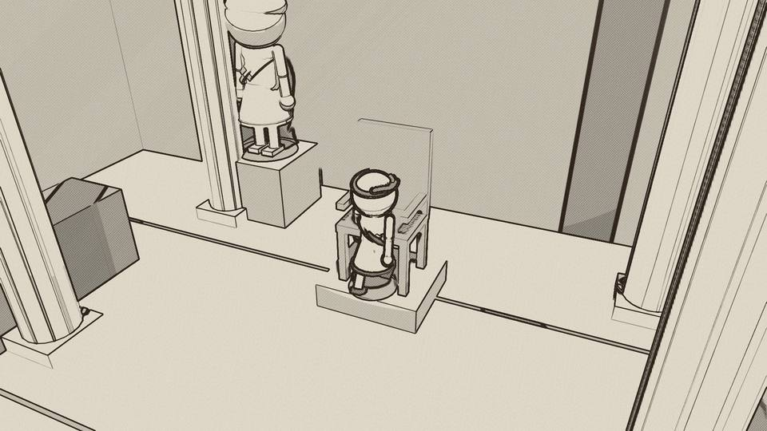

> Caesar takes his seat on a golden chair at the front of the room. He is alone.

- **Frame:** The golden chair, Caesar sits; the doors behind close
- **Motion:** crane down to the chair
- **Sound:** door thud, silence

### 0.6 · 5.4s
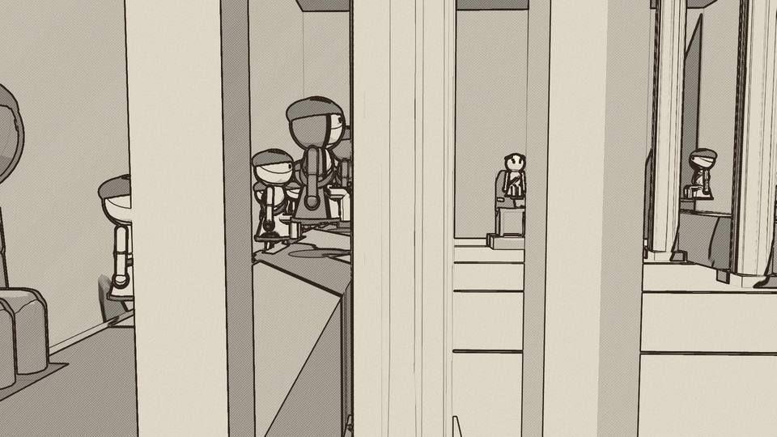

> Across the room, one senator stands up and starts walking toward him.

- **Frame:** A senator rises from the benches; dozens of eyes follow
- **Motion:** slow push past the benches
- **Sound:** bench creak, heartbeat

### 0.7 · 10.2s
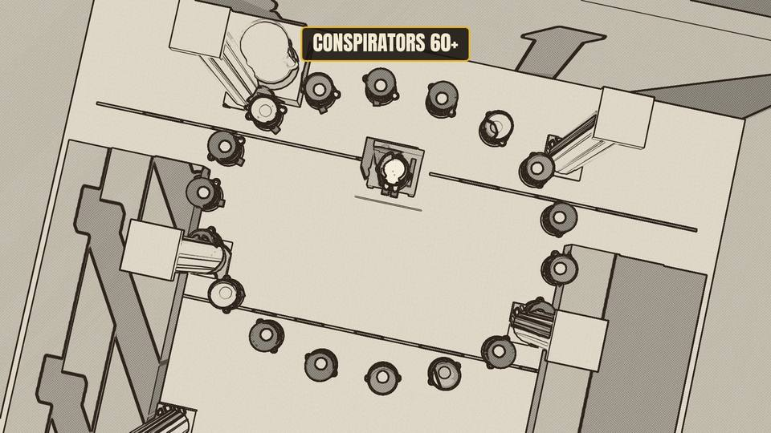

> In the next few minutes, more than sixty men will try to save the Roman Republic. And in doing it, they will destroy it.

- **Frame:** Ring of togas closing around the chair, seen from above
- **Motion:** top-down slow rotation
- **Sound:** rising drone
- **On-screen text:** tally: CONSPIRATORS 60+

### 0.8 · 3.8s
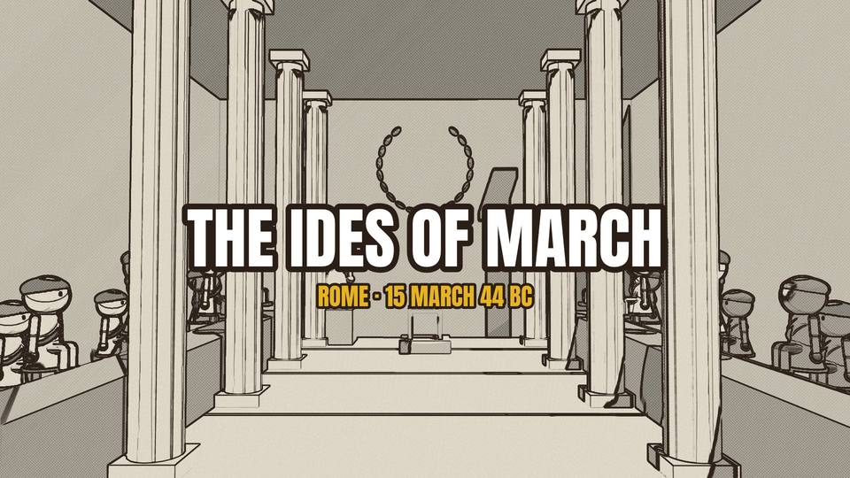

> This is the most famous killing in history.

- **Frame:** "THE IDES OF MARCH" title slams over the Senate hall, laurel emblem
- **Motion:** title slam, then slow push
- **Sound:** title slam, thunder

## Act 1 · Too Powerful (100 TO 45 BC)

### 1.1 · 5.0s
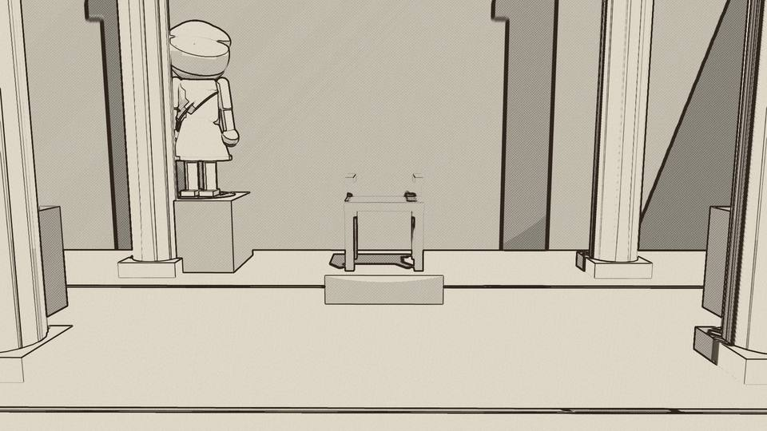

> To understand how Caesar got here, we have to go back.

- **Frame:** The golden chair fades to a young Caesar in a plain toga
- **Motion:** slow dissolve push
- **Sound:** paper swipe

### 1.2 · 5.8s
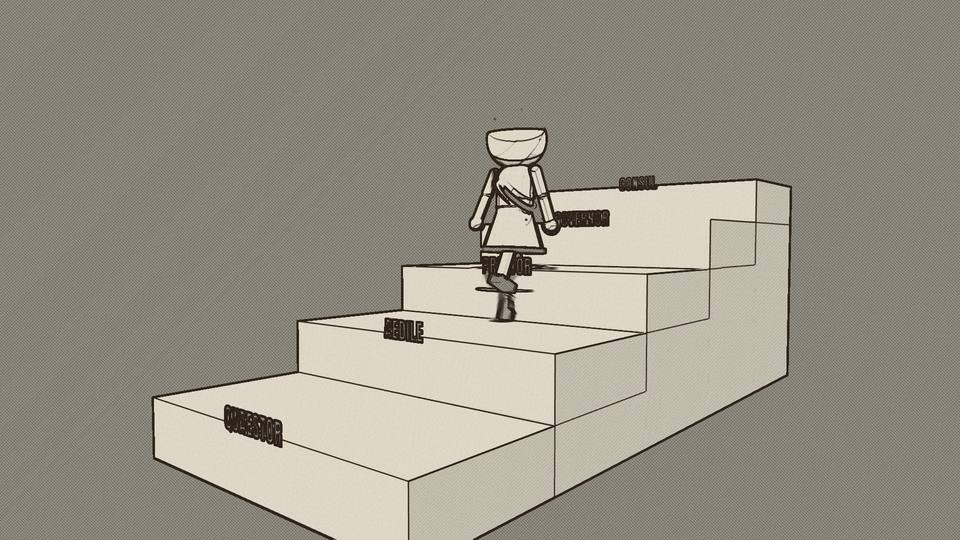

> Over almost forty years in politics, Caesar climbed to Rome's highest office. Consul.

- **Frame:** Caesar climbing a staircase of office titles, "CONSUL" at the top
- **Motion:** crane up the staircase
- **Sound:** step thuds, ding

### 1.3 · 9.0s
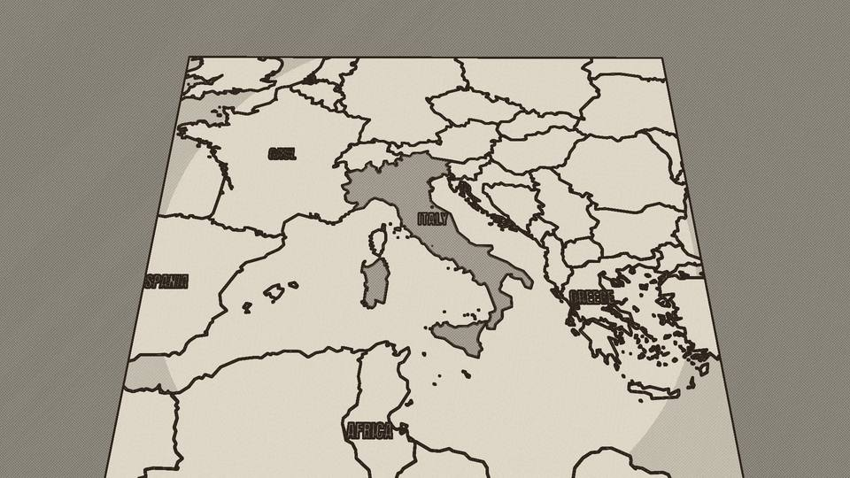

> As a general, he conquered all of Gaul. Today that is France, Belgium and parts of Switzerland, Germany and the Netherlands.

- **Frame:** Parchment map; Gaul floods Roman red, modern names in small labels
- **Motion:** crane over Gaul as it fills
- **Sound:** map flood whoosh, horn
- **On-screen text:** tally: GAUL CONQUERED

### 1.4 · 7.8s
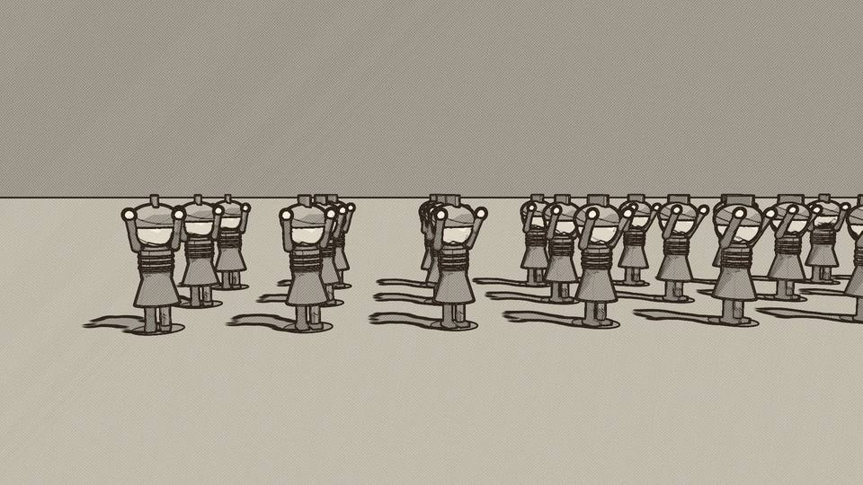

> He was a military genius, and charming with it. His legions were loyal to him, and only him.

- **Frame:** Rows of legionaries turning to salute Caesar, not the Senate standard
- **Motion:** lateral dolly down the ranks
- **Sound:** marching, salute clang

### 1.5 · 8.6s
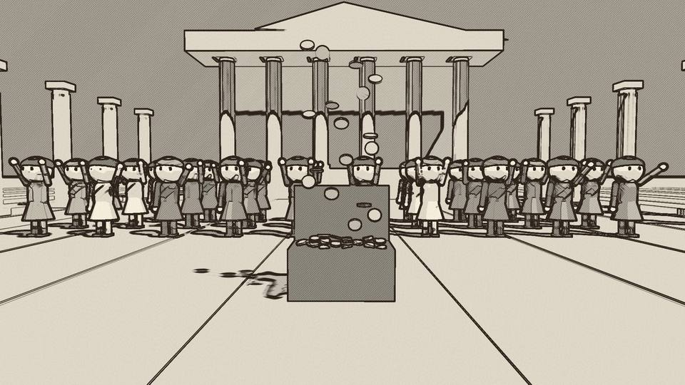

> His wars made him enormously rich. And he spoke for ordinary Romans against the old elite. The people loved him.

- **Frame:** Coins pour into a chest; crowd cheering in the Forum
- **Motion:** push through the crowd
- **Sound:** coins, cheering

### 1.6 · 3.0s
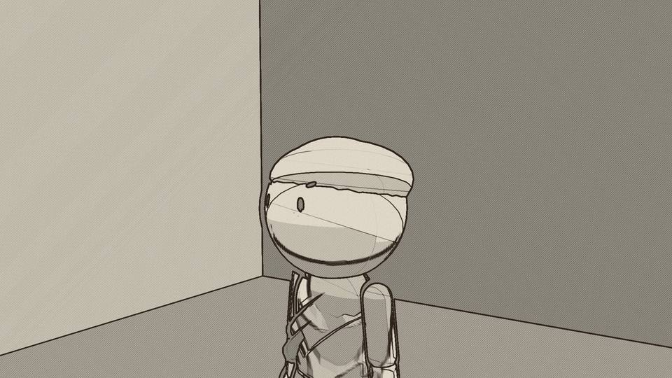

> Maybe they loved him too much.

- **Frame:** The cheering crowd seen from a Senate window, a stern senator watching
- **Motion:** slow push on the senator's frown
- **Sound:** cheering muffled, low tone

### 1.7 · 8.6s
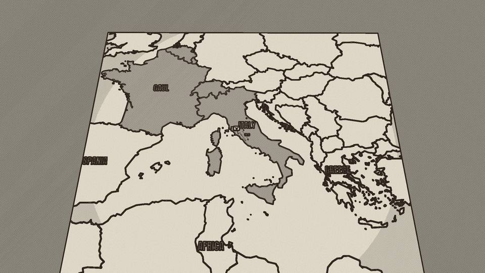

> In 49 BC, the Senate and Caesar's great rival, Pompey, order him to give up his army and come home.

- **Frame:** Map: letter icon flies from Rome to Caesar in Gaul
- **Motion:** follow the letter
- **Sound:** paper whoosh
- **On-screen text:** 49 BC · callout: POMPEY THE GREAT / CAESAR'S RIVAL

### 1.8 · 7.8s
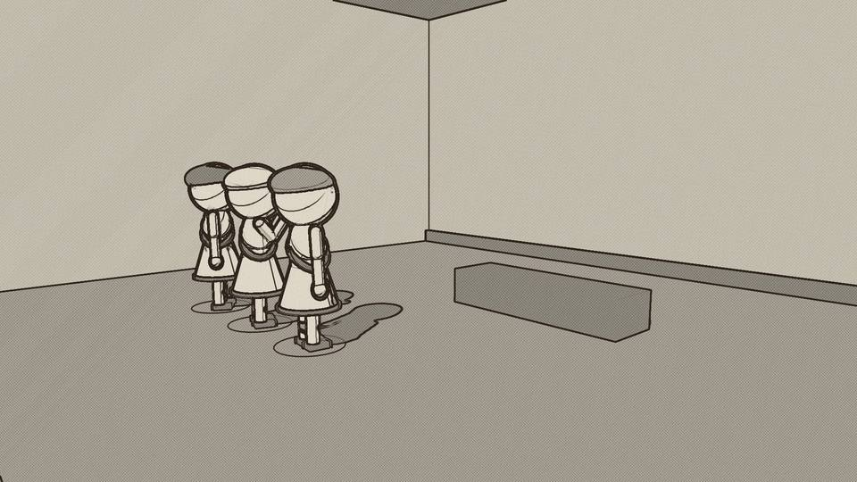

> Without his command, he would lose his legal protection. His enemies were waiting to put him on trial.

- **Frame:** Courtroom with empty defendant's bench and waiting prosecutors
- **Motion:** slow push on the empty bench
- **Sound:** gavel tap

### 1.9 · 9.8s
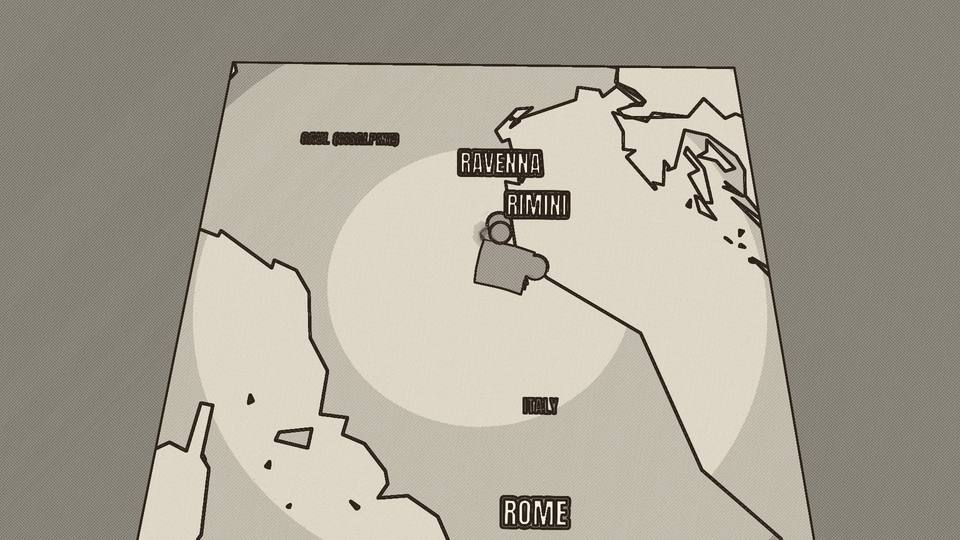

> So Caesar does something no Roman general is allowed to do. He crosses the Rubicon river into Italy, with a legion behind him.

- **Frame:** Map close on northern Italy; the Rubicon line; a legion icon steps across it
- **Motion:** push in on the crossing
- **Sound:** water splash, war horn
- **On-screen text:** RUBICON · 49 BC

### 1.10 · 8.2s
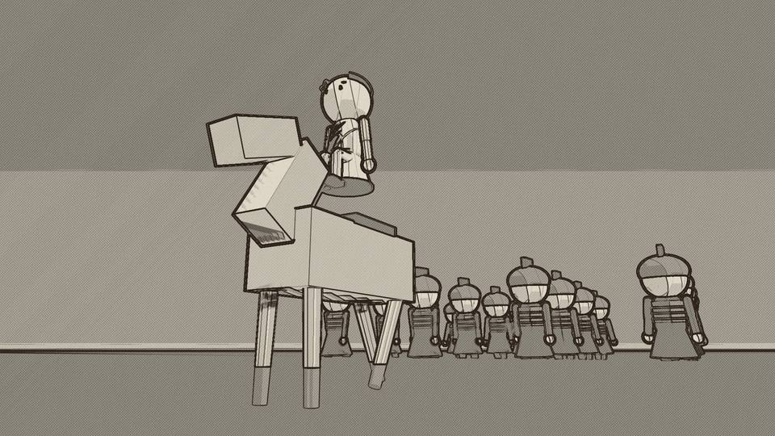

> Roman law said generals had to leave their armies behind at that river. Crossing it with soldiers meant war.

- **Frame:** Caesar on horseback in the shallow river, legion behind, mist
- **Motion:** low angle from the water
- **Sound:** horse hooves in water, drum

### 1.11 · 10.2s
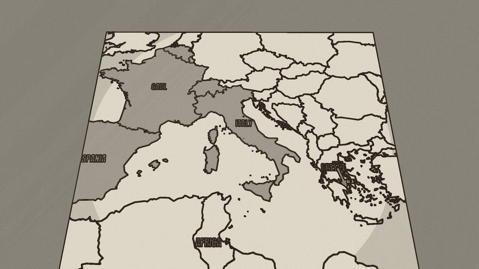

> The civil war spreads across the whole Republic. In 48 BC, Caesar defeats Pompey in Greece. Pompey flees to Egypt and is killed there.

- **Frame:** Map: battle icon at Pharsalus, Pompey's ship to Egypt, a dark X
- **Motion:** follow the arrows
- **Sound:** battle horn, low boom
- **On-screen text:** 48 BC

### 1.12 · 7.0s
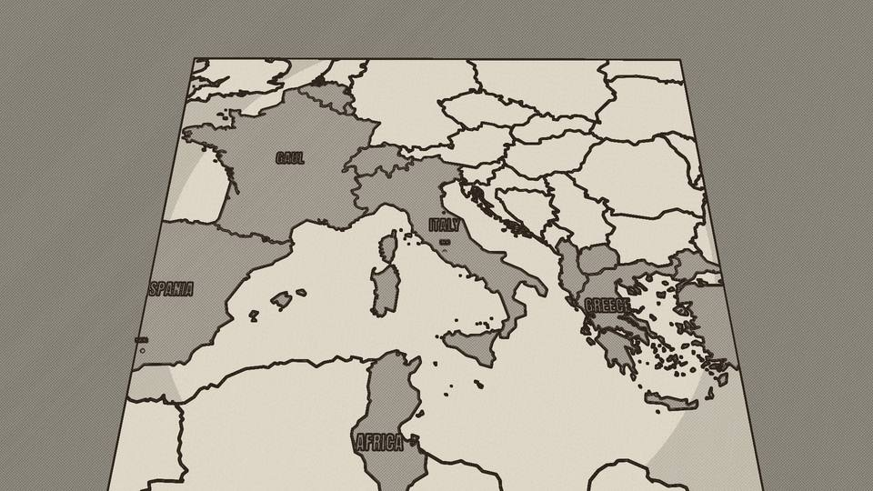

> The last of Pompey's armies is crushed in Spain in March 45 BC. Caesar has won.

- **Frame:** Map: Munda in Spain flashes; the whole Republic turns Caesar red
- **Motion:** crane back to show all of it
- **Sound:** victory horn
- **On-screen text:** 45 BC

### 1.13 · 10.2s
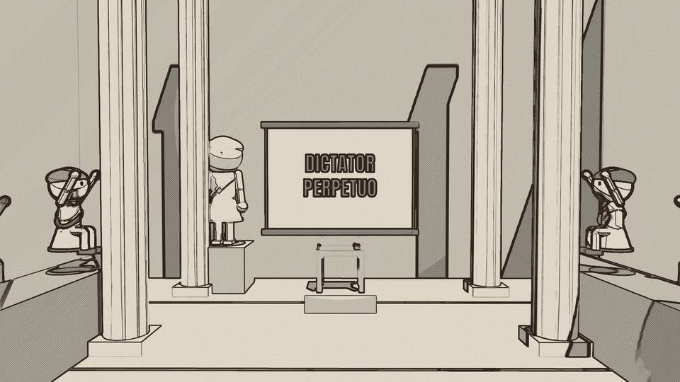

> The Senate that once tried to stop him now gives him everything. Consul again and again. Then, in February 44 BC, dictator for life.

- **Frame:** Senators raising hands; a scroll unrolls "DICTATOR PERPETUO"
- **Motion:** push in on the scroll
- **Sound:** scroll unroll, gavel
- **On-screen text:** FEB 44 BC

## Act 2 · The King Who Wasn'T (509 TO 44 BC)

### 2.1 · 5.4s
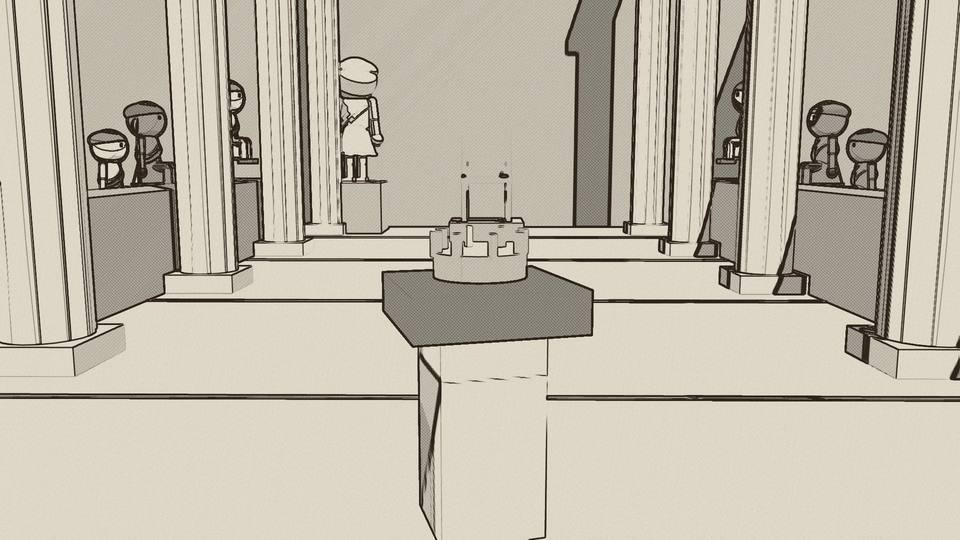

> Meanwhile, one word frightens Rome's old families more than any other. King.

- **Frame:** A golden crown on a cushion, Senate hall in shadow behind
- **Motion:** slow push on the crown
- **Sound:** deep bell

### 2.2 · 5.8s
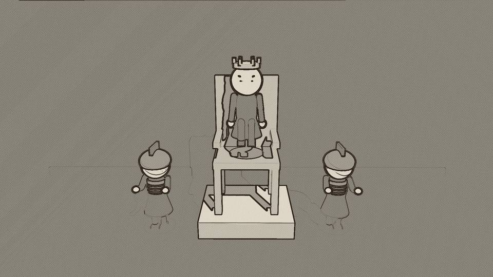

> Rome had kings once. The last was Tarquin the Proud, a cruel tyrant.

- **Frame:** Tarquin on a throne, stern brows, guards on either side
- **Motion:** crane down on the throne
- **Sound:** cold drone
- **On-screen text:** callout: TARQUIN THE PROUD / LAST KING OF ROME

### 2.3 · 7.8s
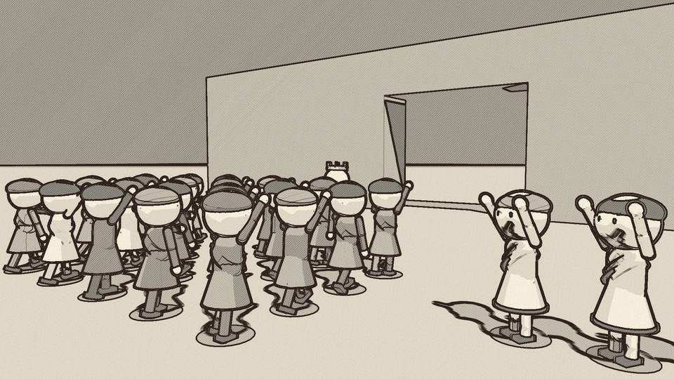

> Around 509 BC, the Romans threw him out, and swore that no king would ever rule Rome again.

- **Frame:** Crowd pushing Tarquin out of the city gate; senators raising hands in an oath
- **Motion:** tracking the crowd
- **Sound:** crowd roar, gate slam
- **On-screen text:** 509 BC

### 2.4 · 9.8s
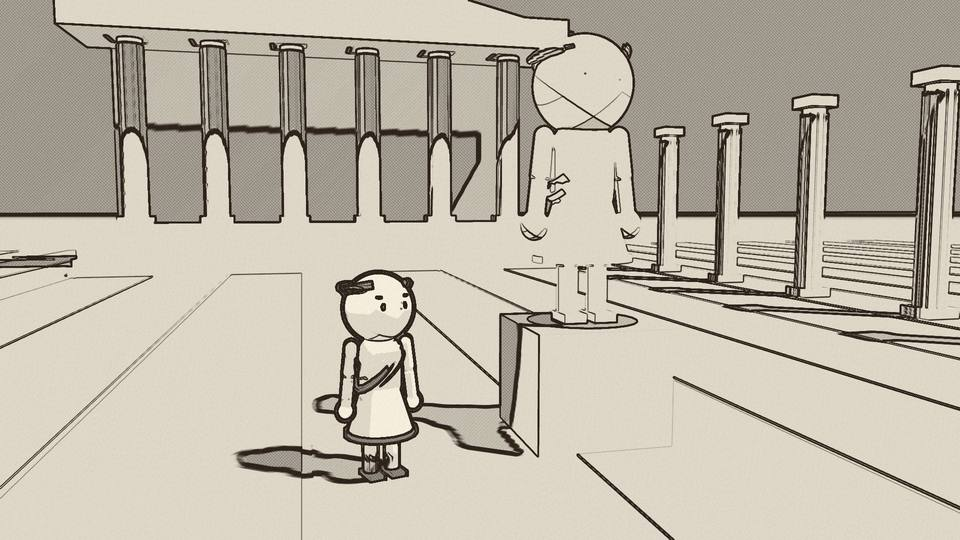

> Now it looks as if Caesar wants to be one. He wears royal purple and puts up statues of himself around the city.

- **Frame:** Caesar in a purple toga beside a new statue of himself
- **Motion:** orbit the statue
- **Sound:** stone thud, chisel taps

### 2.5 · 7.4s
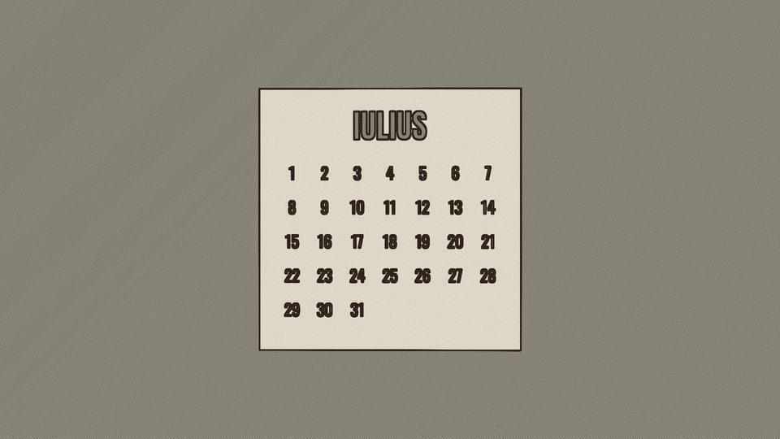

> His allies rename the month of his birth, Quintilis, after him. Julius. We still call it July.

- **Frame:** Calendar page flips from QUINTILIS to IULIUS to JULY
- **Motion:** calendar flip
- **Sound:** page flips, ding

### 2.6 · 8.6s
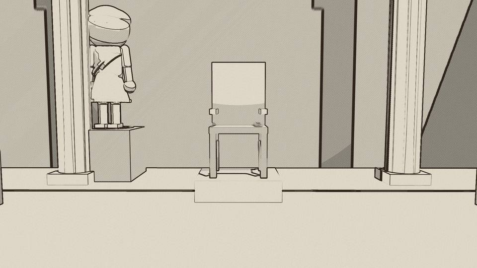

> He even has a golden chair made for him in the Senate. The same chair he is sitting on today.

- **Frame:** The golden chair gleams; the camera links it to Act 0's chair
- **Motion:** slow push
- **Sound:** shimmer chime

### 2.7 · 10.6s
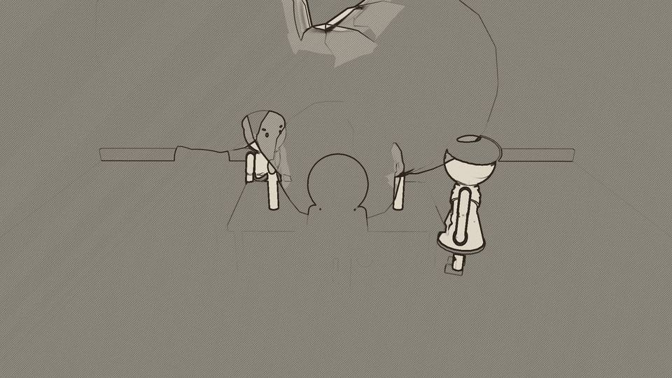

> For his enemies, Caesar is a threat to the Republic itself. They cannot beat him in battle. So they will have to find another way.

- **Frame:** Shadowy figures in togas meeting by candlelight
- **Motion:** slow push through the candle smoke
- **Sound:** candle flicker, whisper

## Act 3 · The Conspiracy (EARLY 44 BC)

### 3.1 · 5.4s
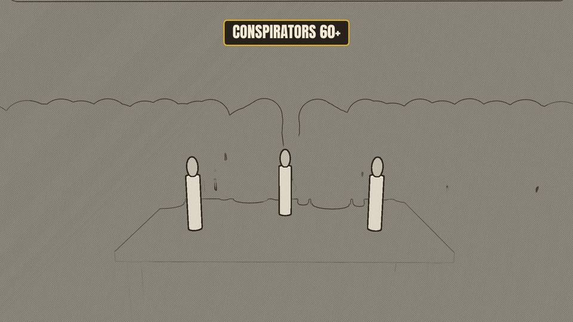

> About sixty men join the plot. They come from very different places.

- **Frame:** Sixty silhouettes in togas fill a dark hall
- **Motion:** crane up and back
- **Sound:** murmur, footsteps
- **On-screen text:** tally: CONSPIRATORS 60+

### 3.2 · 5.0s
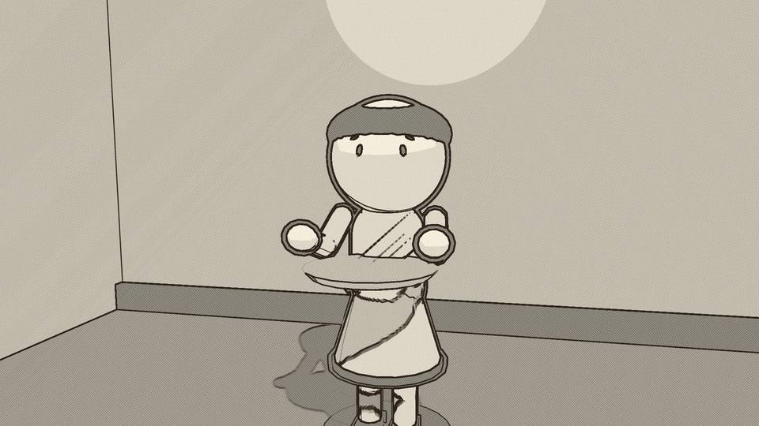

> Some are old allies who feel Caesar never rewarded them enough.

- **Frame:** Senator with an empty reward plate
- **Motion:** push in
- **Sound:** plate clink

### 3.3 · 5.4s
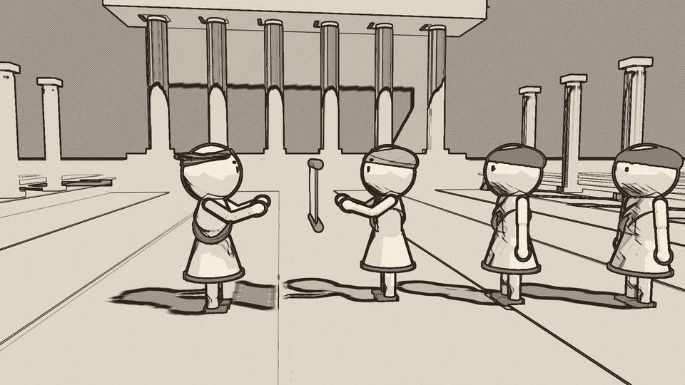

> Some fought against him for Pompey, and were pardoned by Caesar himself.

- **Frame:** Former enemies receiving a pardon scroll from Caesar; red ink stamp "PARDONED"
- **Motion:** lateral dolly
- **Sound:** stamp

### 3.4 · 5.4s
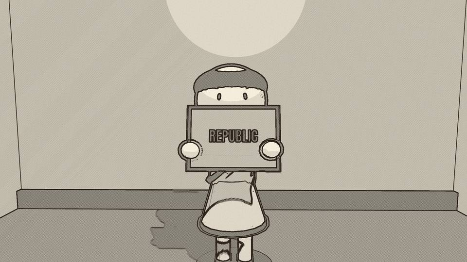

> A few simply believe in the Republic, and see a king coming.

- **Frame:** A senator with a wax tablet reading "REPUBLIC"
- **Motion:** slow push
- **Sound:** stylus scratch

### 3.5 · 9.0s
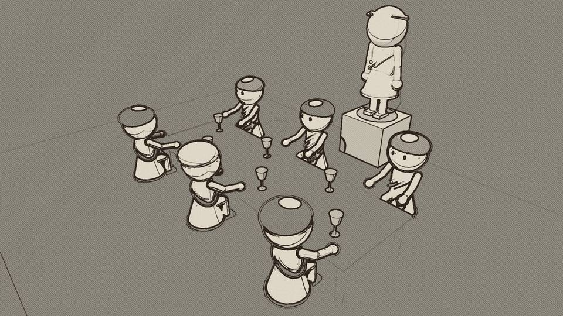

> And most belong to the old aristocracy, who run the Senate and do not want to share power with one man.

- **Frame:** Rich senators at a banquet table, frowning at Caesar's statue
- **Motion:** crane over the table
- **Sound:** goblets clink

### 3.6 · 3.8s
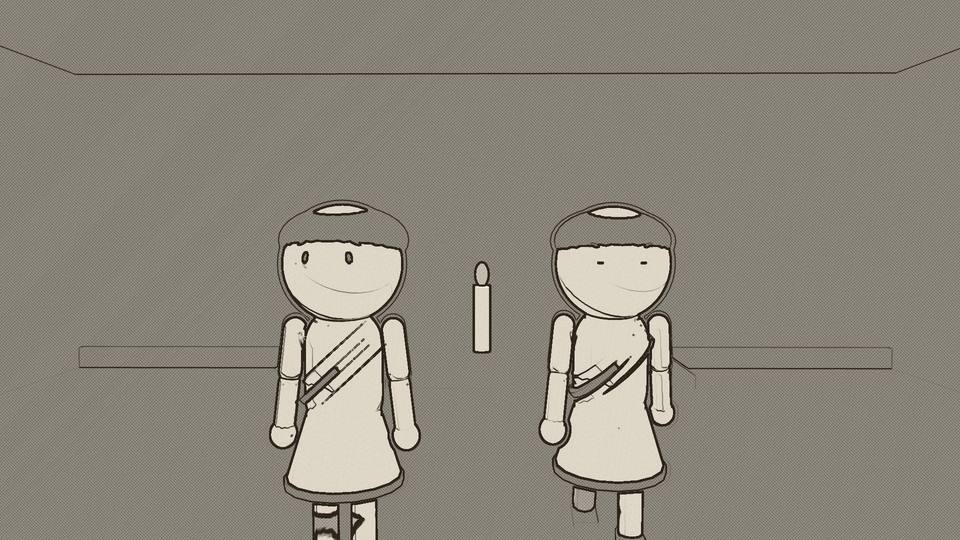

> Their leaders include Marcus Brutus and Gaius Cassius.

- **Frame:** Two figures step forward; name callouts
- **Motion:** push in on both
- **Sound:** drum hit
- **On-screen text:** callout: MARCUS BRUTUS · GAIUS CASSIUS / LEADING CONSPIRATORS

### 3.7 · 6.6s
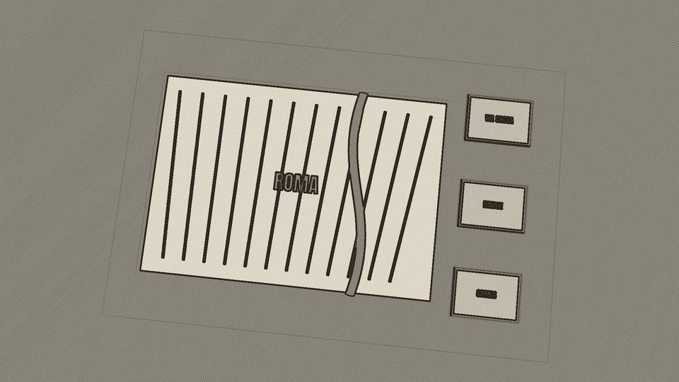

> For months they meet in secret. And they look at different ways to do it.

- **Frame:** A table with a city map and three wax tablets
- **Motion:** top-down push
- **Sound:** tablet clacks

### 3.8 · 7.8s
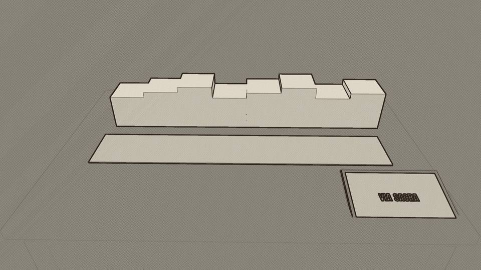

> Plan one. Attack him in the street, on the Via Sacra. Too public. His friends might be nearby.

- **Frame:** Street scene on the Via Sacra, a red X stamps the tablet
- **Motion:** push in, X stamp
- **Sound:** crowd noise, X stamp

### 3.9 · 5.8s
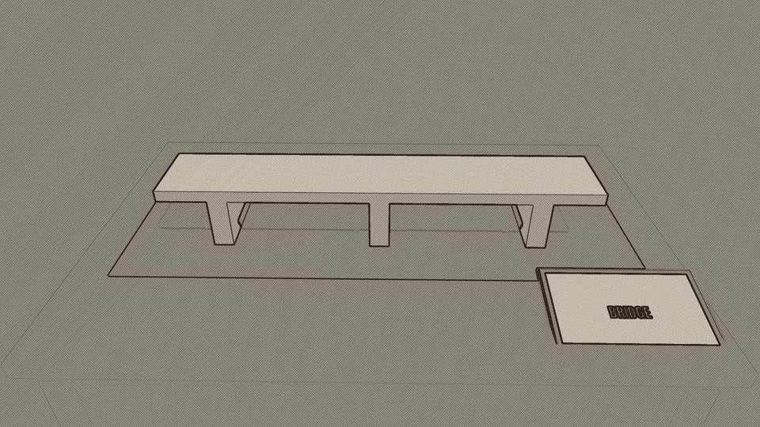

> Plan two. Throw him off a bridge, with armed men waiting below. Ambitious.

- **Frame:** Tiny bridge model with tiny men underneath, a red X stamps it
- **Motion:** top-down, X stamp
- **Sound:** water splash, X stamp

### 3.10 · 5.0s
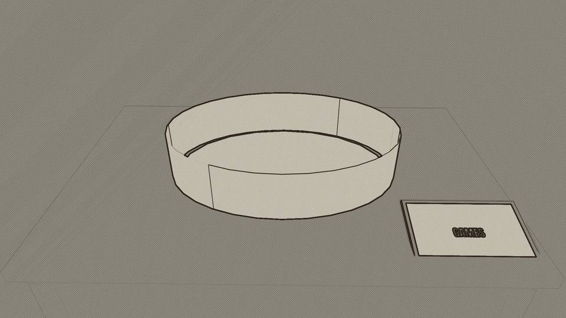

> Plan three. Hide among the gladiators at a show. Also rejected.

- **Frame:** Arena model, red X stamps it
- **Motion:** push in, X stamp
- **Sound:** crowd roar, X stamp

### 3.11 · 7.4s
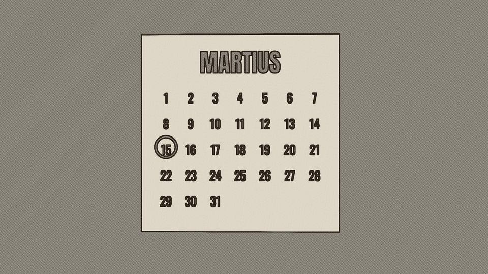

> In the end they choose a meeting of the Senate on the fifteenth of March, the Ides.

- **Frame:** Calendar with the 15th circled in red
- **Motion:** push in on the circle
- **Sound:** quill scratch
- **On-screen text:** IDES OF MARCH

### 3.12 · 9.0s
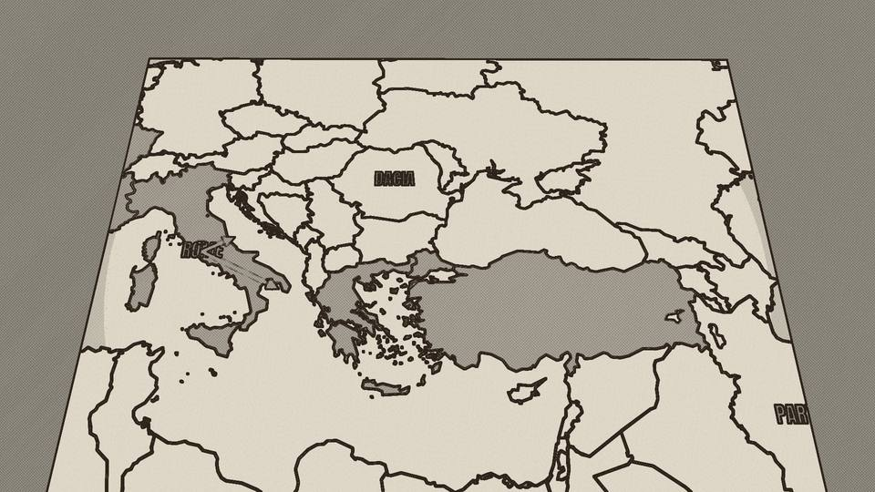

> Three days later, Caesar is leaving Rome on a huge new war in the east, against the Dacians and the Parthians.

- **Frame:** Map: arrows from Rome toward Dacia and Parthia
- **Motion:** follow the arrows east
- **Sound:** war horn

### 3.13 · 8.6s
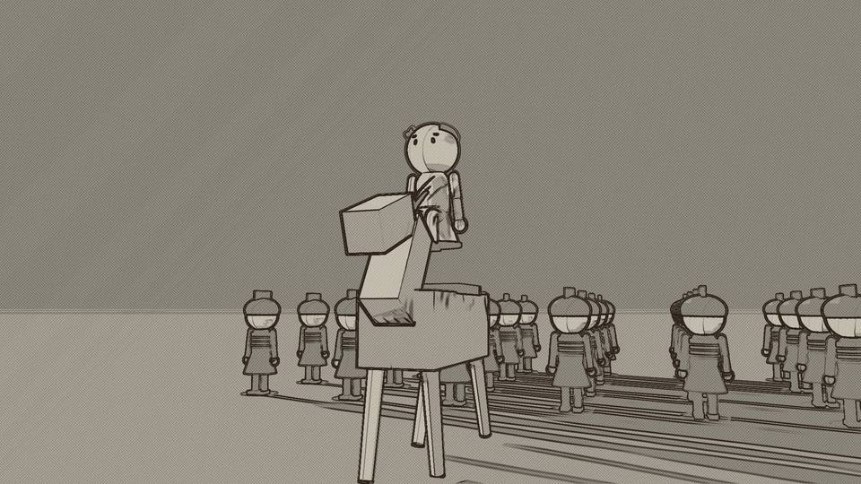

> Once he leaves, he will be out of reach for years, and he will come back with even more glory.

- **Frame:** Caesar on horseback at the head of an army, sun behind
- **Motion:** slow push
- **Sound:** marching

### 3.14 · 7.8s
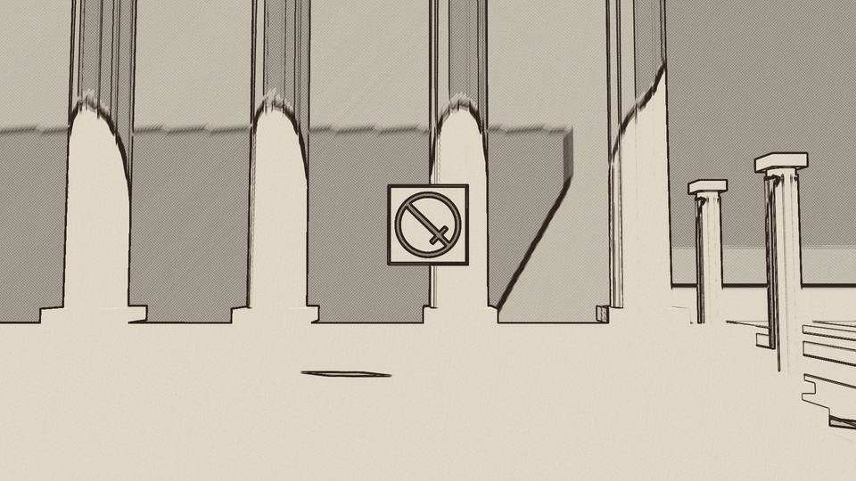

> A Senate meeting is perfect. Weapons are not allowed inside, so no one will be armed. Except them.

- **Frame:** Senate doorway with a sign of a crossed-out sword
- **Motion:** push in on the sign
- **Sound:** stone thud

### 3.15 · 7.4s
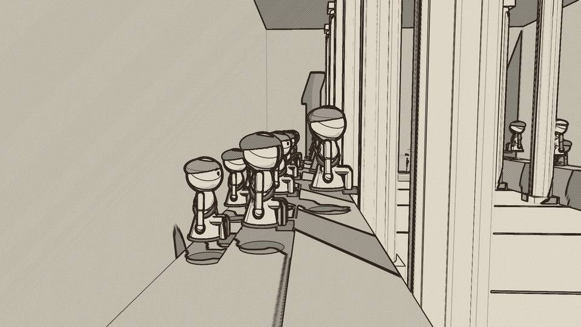

> Most senators are loyal to Caesar. But few will jump in front of a blade for him.

- **Frame:** Rows of senators looking nervous, glancing at each other
- **Motion:** lateral dolly along the benches
- **Sound:** nervous murmur

## Act 4 · The Trap (15 MARCH 44 BC)

### 4.1 · 6.2s
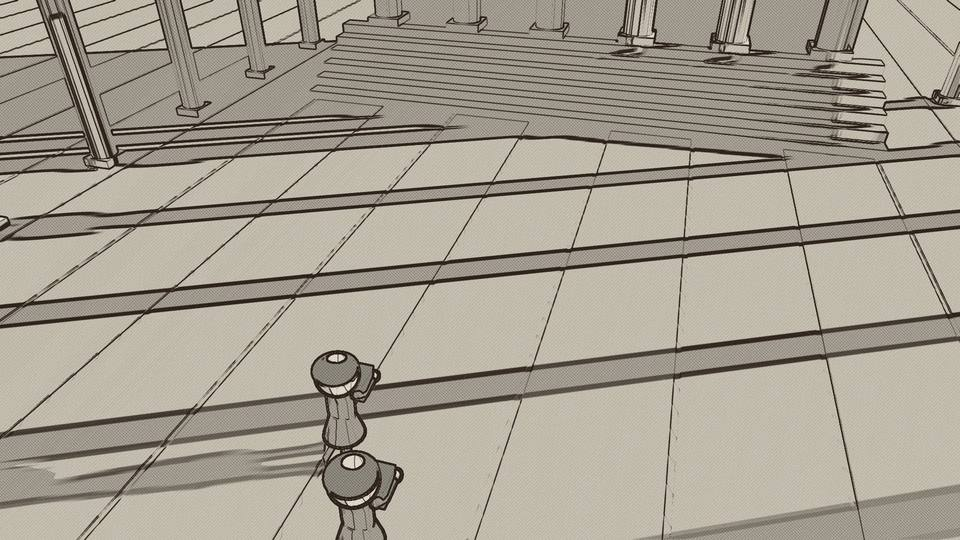

> On the morning of the fifteenth, daggers are carried into the Curia of Pompey.

- **Frame:** Morning at the Curia, servants carry wooden boxes
- **Motion:** crane down to the doorway
- **Sound:** footsteps, birds
- **On-screen text:** 15 MARCH · MORNING

### 4.2 · 5.8s
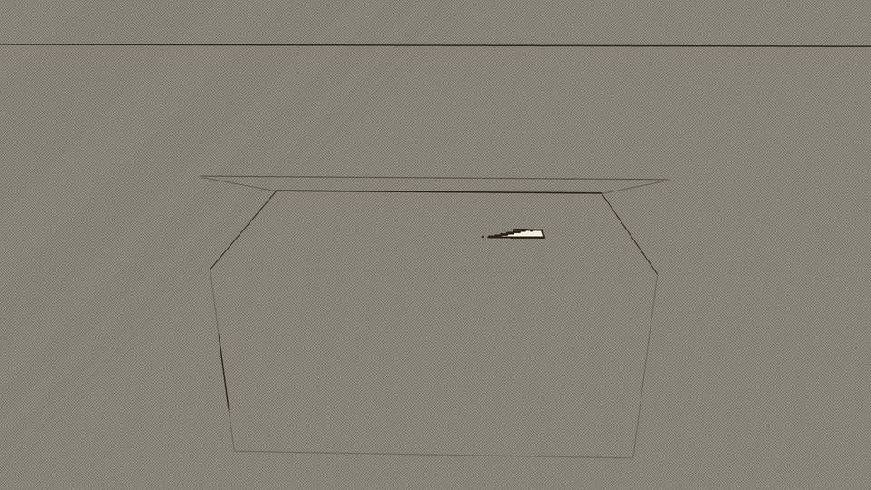

> They are hidden in the wooden boxes normally used to carry writing tablets.

- **Frame:** Box lid opens a crack, a glint inside; lid closes
- **Motion:** close push
- **Sound:** box creak, metal glint ding

### 4.3 · 5.0s
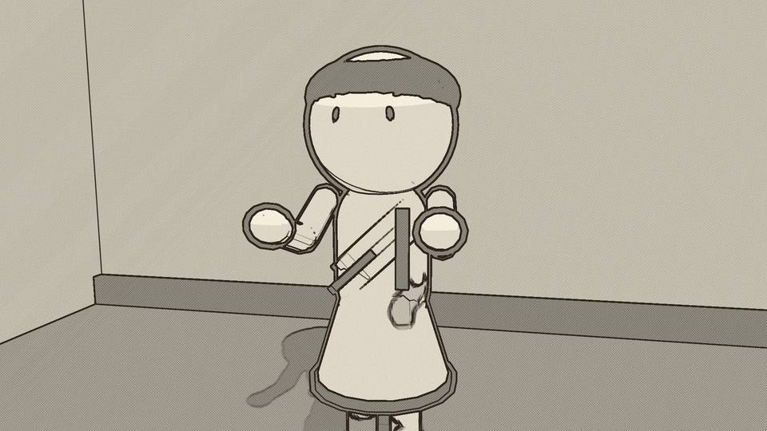

> The conspirators take them out and hide them under their togas.

- **Frame:** A senator adjusts his toga, a dagger shape vanishes beneath the fold
- **Motion:** slow push
- **Sound:** cloth rustle

### 4.4 · 7.0s
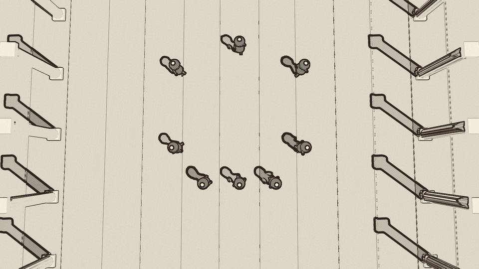

> Outside, the gladiators take their places by the exits. If Caesar runs, he won't get far.

- **Frame:** Gladiators spread to the courtyard exits, top-down plan view
- **Motion:** top-down crane
- **Sound:** armour clinks

### 4.5 · 7.8s
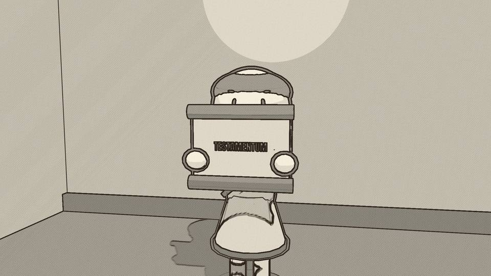

> The gladiators belong to Decimus Brutus, one of Caesar's closest friends. A man named in Caesar's own will.

- **Frame:** Decimus Brutus with the will scroll; name callout
- **Motion:** push in on the scroll
- **Sound:** scroll unroll
- **On-screen text:** callout: DECIMUS BRUTUS / CAESAR'S FRIEND

### 4.6 · 5.8s
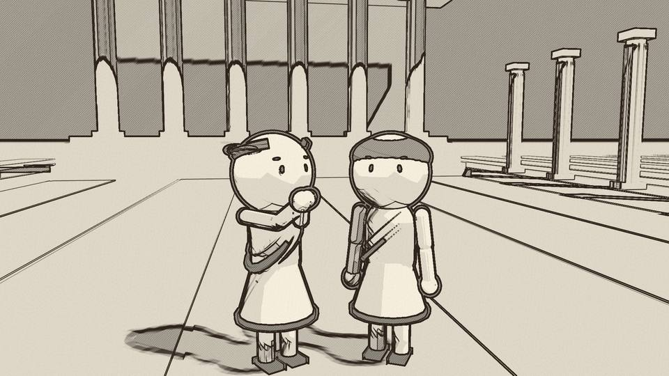

> Caesar trusts him completely. He would never question why Decimus's gladiators are there.

- **Frame:** Caesar and Decimus laughing together, Caesar's hand on his shoulder
- **Motion:** slow orbit
- **Sound:** soft laugh, low tone

### 4.7 · 7.8s
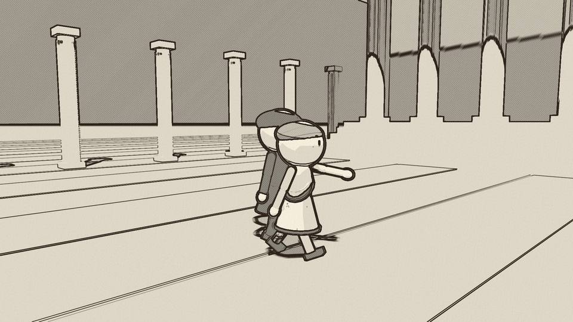

> And when Caesar arrives with Mark Antony, a senator named Gaius Trebonius takes Antony aside for a chat.

- **Frame:** Trebonius steering Antony away from the door
- **Motion:** tracking the two
- **Sound:** chatter
- **On-screen text:** callout: GAIUS TREBONIUS / CONSPIRATOR

### 4.8 · 7.0s

> Antony is big, strong, and completely loyal. The plotters made sure he would not be inside.

- **Frame:** Antony's broad shoulders in frame as the doors close behind him
- **Motion:** push in on the closing doors
- **Sound:** door thud

### 4.9 · 9.8s

> They had thought about killing Antony too. They decided against it. Killing Caesar alone would look like punishing a tyrant, not a massacre.

- **Frame:** Two scales: one figure vs two figures; the single figure stays
- **Motion:** scale animation
- **Sound:** scale creak

### 4.10 · 5.0s

> The stage is set. All they need now is a signal.

- **Frame:** Wide shot of the hall, Caesar on his chair, sixty togas still
- **Motion:** slow crane up
- **Sound:** silence, heartbeat

## Act 5 · The Ides Of March (15 MARCH 44 BC)

### 5.1 · 9.8s

> The signal is a senator called Tillius Cimber. He walks up to Caesar and begs him to bring his brother home from exile.

- **Frame:** Cimber kneels before the chair, hands raised
- **Motion:** slow push from behind Cimber
- **Sound:** footsteps, pleading murmur
- **On-screen text:** callout: TILLIUS CIMBER / CONSPIRATOR

### 5.2 · 6.2s

> Dozens of senators stand up and crowd around, all pleading for the same thing.

- **Frame:** Togas rise from the benches and close in like a tide
- **Motion:** top-down rotation as the ring tightens
- **Sound:** rising crowd voices

### 5.3 · 5.4s

> Then Cimber grabs Caesar's toga and pulls it down off his shoulders.

- **Frame:** Cimber grabs the toga; Caesar's surprised brows
- **Motion:** close push
- **Sound:** cloth tear

### 5.4 · 3.4s

> Caesar shouts in shock. This is violence.

- **Frame:** Caesar half-standing, mouth open
- **Motion:** quick push in
- **Sound:** shout echo

### 5.5 · 5.8s

> Behind him, a senator named Casca strikes first. The blow only grazes him.

- **Frame:** Casca's silhouette behind the chair, a dark shape; cut to black on the strike
- **Motion:** cut to black
- **Sound:** one sharp sting, silence
- **On-screen text:** callout: PUBLIUS CASCA / FIRST BLOW

### 5.6 · 11.8s

> Caesar spins around and, according to one ancient writer, stabs Casca in the arm with his stylus. His pen. Sadly, the pen is not mightier than the sword.

- **Frame:** Close on a writing stylus in Caesar's mitten hand; a tiny "OUCH" in comic font
- **Motion:** push in on the stylus
- **Sound:** pen jab, comic boing
- **On-screen text:** chip: SUETONIUS'S ACCOUNT

### 5.7 · 4.2s

> In seconds, Caesar disappears inside a crowd of togas.

- **Frame:** The ring of togas closes over the chair from above; no blades visible
- **Motion:** top-down, camera sinks
- **Sound:** cloth rushing, low drone

### 5.8 · 6.6s

> Two of his loyal friends try to push through to him. They are pushed back.

- **Frame:** Two senators shoved back at the edge of the crowd
- **Motion:** lateral dolly
- **Sound:** scuffle

### 5.9 · 5.0s

> Marcus Brutus is in the crowd too, and strikes as well.

- **Frame:** Brutus's face among the togas, then cut to black
- **Motion:** slow push, cut to black
- **Sound:** single sting, silence

### 5.10 · 9.0s

> Caesar is struck twenty-three times. A doctor later said only one of those wounds was fatal, the second, to his chest.

- **Frame:** Black screen with a white tally counting to 23; doctor's note card
- **Motion:** tally tick
- **Sound:** soft ticks, bell
- **On-screen text:** tally: WOUNDS 23

### 5.11 · 9.0s

> And his famous last words? "Et tu, Brute," "you too, Brutus," comes from Shakespeare, written more than sixteen hundred years later.

- **Frame:** Quill writing "ET TU, BRUTE?" on paper, a "SHAKESPEARE, 1599" stamp
- **Motion:** push in on the quill
- **Sound:** quill scratch, stamp
- **On-screen text:** chip: SHAKESPEARE, NOT HISTORY

### 5.12 · 8.6s

> One ancient writer says Caesar said nothing at all. Others say his last words were in Greek. "You too, child?"

- **Frame:** Two cards: "SILENCE" and "KAI SU, TEKNON?"
- **Motion:** card flips
- **Sound:** card flips
- **On-screen text:** chip: SUETONIUS: REPORTED, NOT CERTAIN

### 5.13 · 9.0s

> He falls at the foot of a statue. A statue of Pompey, the rival he defeated, and refused to tear down.

- **Frame:** The marble statue of Pompey looking down at the empty golden chair; a fallen toga at its base, no blood
- **Motion:** slow crane up the statue
- **Sound:** marble echo, single bell

## Act 6 · The Warnings (FEB TO 15 MARCH 44 BC)

### 6.1 · 7.8s

> Caesar should have seen it coming. Ancient writers say the warnings had been piling up for a month.

- **Frame:** An hourglass turning back; sand flows upward
- **Motion:** slow push
- **Sound:** reverse whoosh
- **On-screen text:** FEB 44 BC

### 6.2 · 8.2s

> In February, a soothsayer named Spurinna made a sacrifice for him. The animal, it was said, had no heart.

- **Frame:** An altar with smoke, Spurinna reading the omens; a red question mark
- **Motion:** push in on Spurinna
- **Sound:** fire crackle
- **On-screen text:** callout: SPURINNA / SOOTHSAYER

### 6.3 · 8.6s

> Spurinna warned him his life was in danger, and that it would come no later than the Ides of March.

- **Frame:** Spurinna pointing at a calendar, 15 circled
- **Motion:** push in on the calendar
- **Sound:** bell

### 6.4 · 8.6s

> On the night before, at dinner, the talk turned to the best kind of death. Caesar said, "A sudden one."

- **Frame:** Dinner table, goblets, Caesar raising a hand
- **Motion:** slow orbit around the table
- **Sound:** goblets clink, laughter fades
- **On-screen text:** 14 MARCH 44 BC · chip: PLUTARCH'S ACCOUNT

### 6.5 · 6.2s

> That night, the doors and windows of his bedroom flew open all at once.

- **Frame:** Bedroom, shutters bang open, curtains blow in
- **Motion:** quick push
- **Sound:** wind gust, shutters bang

### 6.6 · 10.2s

> His wife, Calpurnia, cried in her sleep. In the morning she begged him not to go. She had dreamed she was holding his body.

- **Frame:** Calpurnia clutching Caesar's arm at dawn
- **Motion:** over-the-shoulder on Calpurnia
- **Sound:** soft cry, birds
- **On-screen text:** callout: CALPURNIA / CAESAR'S WIFE

### 6.7 · 7.4s

> Caesar was not very superstitious. But he called his own priests. Every sign they read was bad.

- **Frame:** Priests shaking their heads over an altar
- **Motion:** lateral dolly
- **Sound:** fire crackle, murmur

### 6.8 · 3.0s

> So he decided not to go.

- **Frame:** Caesar sits back down, takes off his laurel
- **Motion:** slow push
- **Sound:** soft thud

### 6.9 · 10.2s

> Then his friend Decimus Brutus came to the house. You called this meeting, he said. Will you really cancel it because of a dream?

- **Frame:** Decimus at the doorway, persuasive hands
- **Motion:** push in on Decimus
- **Sound:** footsteps, door

### 6.10 · 6.6s

> What would people say? That the dictator of Rome was afraid of his wife's dreams.

- **Frame:** Imaginary gossip bubbles over Roman heads
- **Motion:** bubbles pop in
- **Sound:** bubble pops

### 6.11 · 3.0s

> So Caesar went.

- **Frame:** Caesar puts the laurel back on and walks out
- **Motion:** tracking behind him
- **Sound:** footsteps

### 6.12 · 10.6s

> On the way, a teacher named Artemidorus pushed through the crowd and handed him a scroll. Read this now, he said. It is about you.

- **Frame:** Artemidorus pressing a scroll into Caesar's hand in a busy street
- **Motion:** push in on the scroll
- **Sound:** crowd, paper rustle
- **On-screen text:** callout: ARTEMIDORUS / TEACHER

### 6.13 · 9.8s

> It is said the scroll named the plot. Caesar never read it. He was still holding it when he walked into the Curia.

- **Frame:** Scroll in Caesar's hand, unopened, as the Curia doors close
- **Motion:** slow push to the doors
- **Sound:** door thud

## Act 7 · The Mask (44 TO 27 BC)

### 7.1 · 8.6s

> Meanwhile, the killers thought they had saved the Republic. Instead, they had made a hole in the middle of it.

- **Frame:** Empty golden chair in a silent hall
- **Motion:** slow push
- **Sound:** wind, drone

### 7.2 · 6.6s

> Caesar's adopted son, Octavian, and his ally Mark Antony joined with the general Marcus Lepidus.

- **Frame:** Three figures side by side; name callouts
- **Motion:** crane down
- **Sound:** drum hit
- **On-screen text:** callout: OCTAVIAN · MARK ANTONY · LEPIDUS

### 7.3 · 7.8s

> Together they hunted the assassins down. In 42 BC, Brutus and Cassius were defeated at Philippi, in Greece.

- **Frame:** Map: armies meet at Philippi
- **Motion:** push in on Philippi
- **Sound:** battle horn, boom
- **On-screen text:** 42 BC

### 7.4 · 4.6s

> More war followed, until only one man was left. Octavian.

- **Frame:** Last figure standing on a stage as others fade
- **Motion:** slow push
- **Sound:** music swell

### 7.5 · 8.6s

> In 27 BC, the Senate gave him a new name, Augustus. He became Rome's first emperor. The Republic was over.

- **Frame:** Octavian crowned with laurel, title "AUGUSTUS"
- **Motion:** title slam
- **Sound:** title slam, horns
- **On-screen text:** 27 BC

### 7.6 · 3.4s

> Augustus did not make his father's mistakes.

- **Frame:** Augustus looking at Caesar's statue
- **Motion:** slow push
- **Sound:** soft pad

### 7.7 · 7.4s

> Caesar pardoned his enemies. He promoted them. He gave them honours. He even left Pompey's statues standing.

- **Frame:** Caesar handing pardons to men who later appear in the plot; statue of Pompey
- **Motion:** lateral dolly
- **Sound:** stamp, scroll

### 7.8 · 3.4s

> His mercy may be what killed him.

- **Frame:** The statue of Pompey over the empty chair
- **Motion:** slow push
- **Sound:** single bell

### 7.9 · 7.8s

> Caesar was hated, but not feared. He showed his power openly, and made no effort to hide it.

- **Frame:** Caesar in purple surrounded by statues of himself
- **Motion:** orbit
- **Sound:** low drone

### 7.10 · 9.4s

> The historian John Balsdon put it this way. The next ruler of Rome would have to wear a republican mask, however false.

- **Frame:** A theatre mask of a Roman senator lowered over Augustus's face
- **Motion:** slow push on the mask
- **Sound:** soft thud

### 7.11 · 3.4s

> Augustus wore that mask for forty years.

- **Frame:** Augustus with the mask, crowds bowing
- **Motion:** slow crane up
- **Sound:** music swell

### 7.12 · 6.2s

> If you want more stories like this, subscribe. See you in the next one.

- **Frame:** End card with subscribe button
- **Motion:** card slide
- **Sound:** soft ding
