# Operation Thunderbolt Storyboard

154 shots, sketch frames in img/.

## Act 0 · Cold Open (3 JULY 1976)

### 0.1 · 7.8s
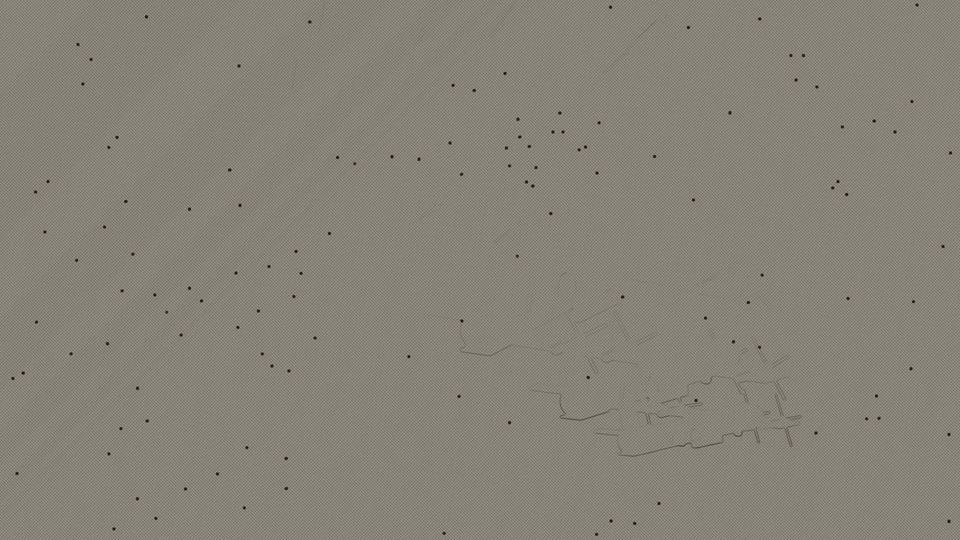

> Eleven at night, 3 July 1976. Four huge military planes fly over Africa with every light switched off.

- **Frame:** Four C-130 Hercules in a row, black against a starfield, cloud tops lit by the moon
- **Motion:** slow lateral dolly along the formation, camera 30 m below the lead wing
- **Sound:** low engine drone, wind
- **On-screen text:** 23:00 · 3 JULY 1976

### 0.2 · 7.0s
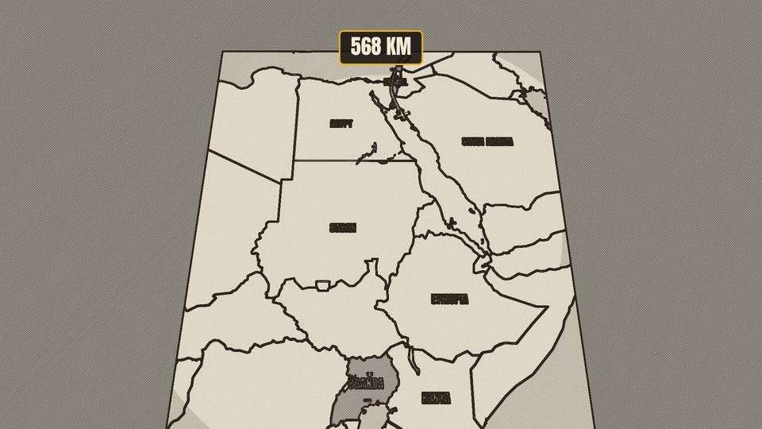

> They have come four thousand kilometres from Israel, flying so low that no radar sees them.

- **Frame:** Parchment map, Israel to Uganda; gold route ribbon grows down the Red Sea; "4,000 KM" counter ticks up
- **Motion:** crane down from above Sinai, follow the ribbon south
- **Sound:** map paper swipe, counter ticks
- **On-screen text:** RED SEA · tally: 4,000 KM

### 0.3 · 8.2s
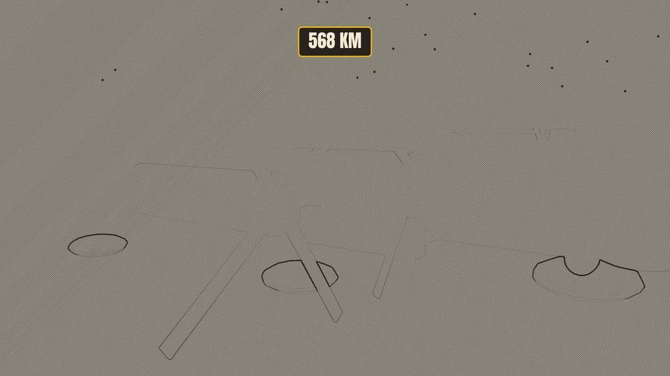

> Near the target, the lead plane shuts down two of its four engines so it lands almost in silence.

- **Frame:** Close on the wing: two propellers slow and stop, the other two keep turning
- **Motion:** push in on the stopping propellers
- **Sound:** engine spool down, propeller whoosh fading

### 0.4 · 9.8s
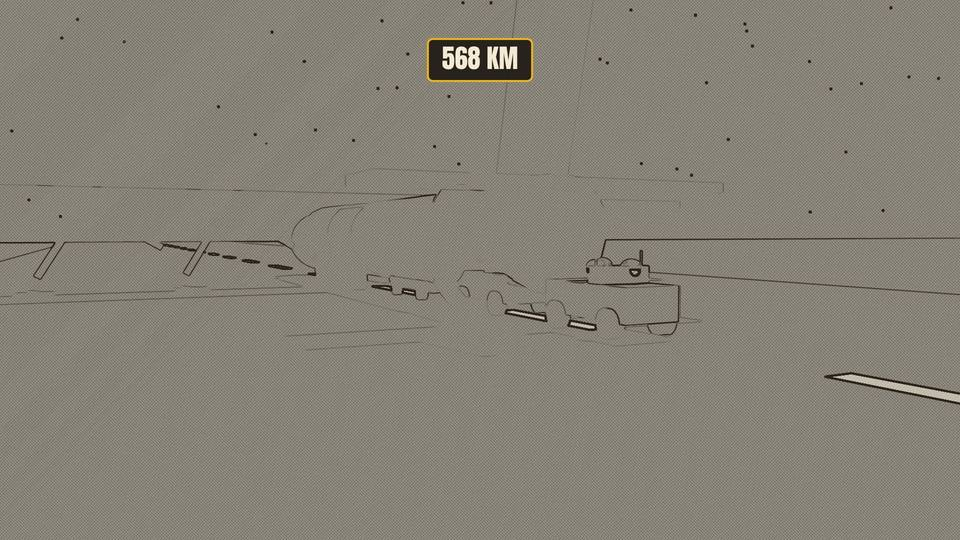

> Its ramp opens while it is still rolling. Out comes a black Mercedes, built to look exactly like the car of Uganda's president.

- **Frame:** Ramp lowers on a dark runway; a black Mercedes and two Land Rovers roll out with flags on the bonnet
- **Motion:** low angle from the runway, ramp opens toward camera
- **Sound:** hydraulic whine, ramp clank, car engine
- **On-screen text:** ENTEBBE · 23:01

### 0.5 · 7.4s
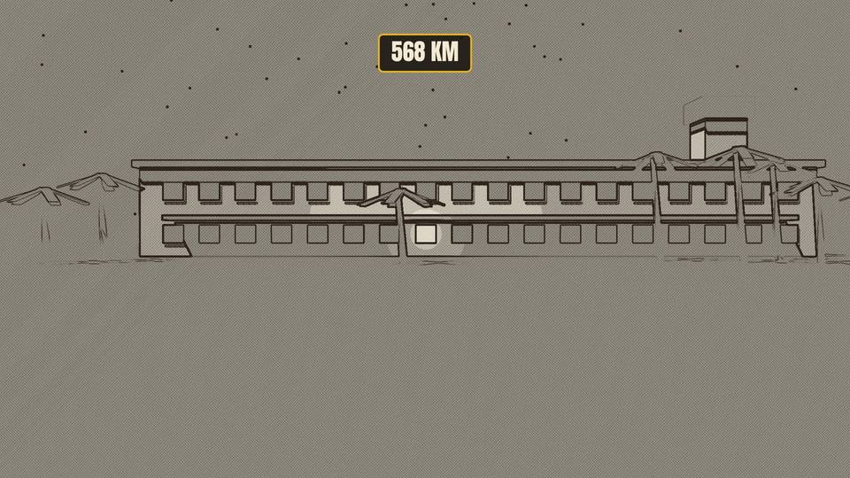

> Inside an old airport terminal, a hundred and six hostages are waiting. Their deadline is tomorrow afternoon.

- **Frame:** Old terminal at night, one window lit, silhouettes of people lying on the floor inside
- **Motion:** slow push toward the lit window
- **Sound:** clock tick, distant generator hum
- **On-screen text:** tally: HOSTAGES 106

### 0.6 · 6.6s
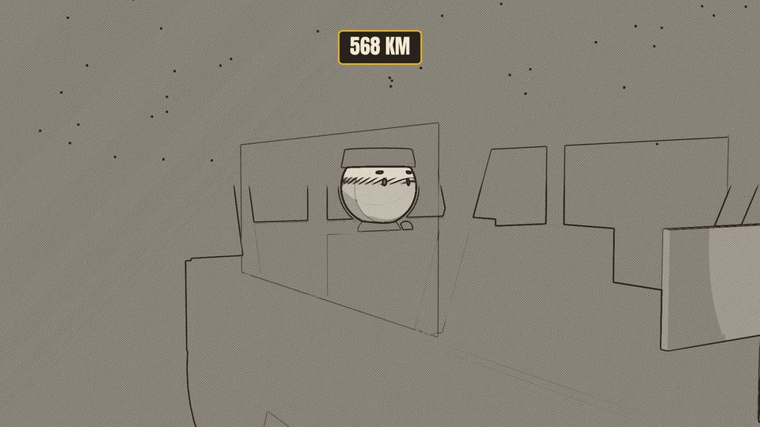

> The man leading the first team is thirty years old. His name is Yonatan Netanyahu.

- **Frame:** Yoni in olive uniform and cap, sitting in the Mercedes, eyes calm; name callout
- **Motion:** over-the-shoulder close, slight handheld drift
- **Sound:** car interior rumble, heartbeat
- **On-screen text:** callout: YONATAN "YONI" NETANYAHU / COMMANDER, 30

### 0.7 · 10.6s
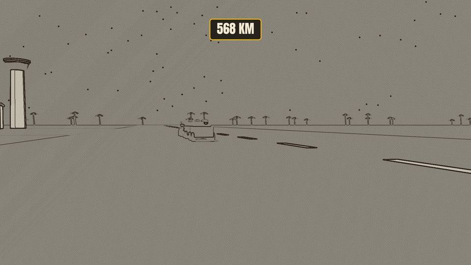

> In the next ninety minutes, Israel will try something no army had done before. A rescue in an enemy country, four thousand kilometres from home.

- **Frame:** The convoy moves toward the terminal, headlights off, the airport tower ahead
- **Motion:** camera rises and pulls back to reveal the whole airport
- **Sound:** drum hit, rising drone

### 0.8 · 3.0s
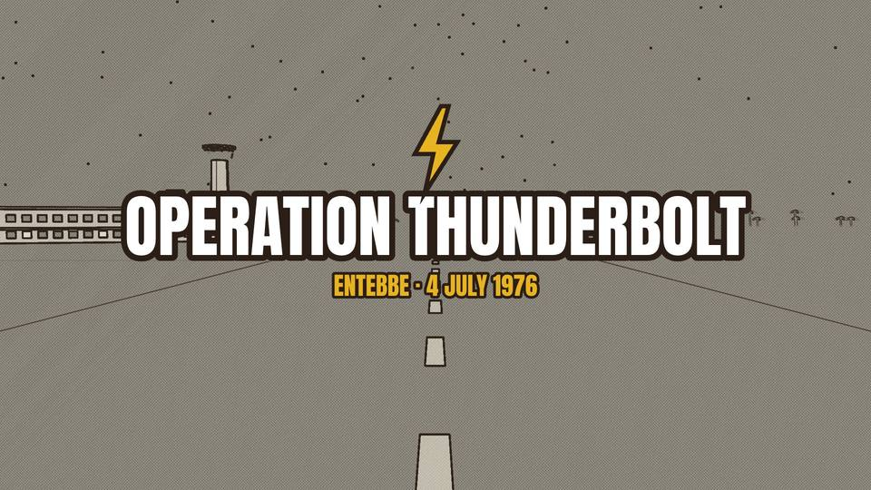

> This is Operation Thunderbolt.

- **Frame:** "OPERATION THUNDERBOLT" slams in over the dark runway, lightning bolt emblem
- **Motion:** title slam 1.9x to 1x, then slow push
- **Sound:** thunder boom, title slam

## Act 1 · Flight 139 (27 JUNE 1976)

### 1.1 · 5.0s
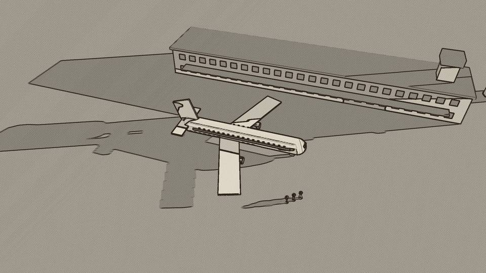

> Let's go back one week. Tel Aviv, Sunday 27 June 1976.

- **Frame:** Ben Gurion airport, morning sun, an Air France Airbus A300 at the gate
- **Motion:** crane down from sky to the jet
- **Sound:** airport chime, birds

### 1.2 · 7.0s
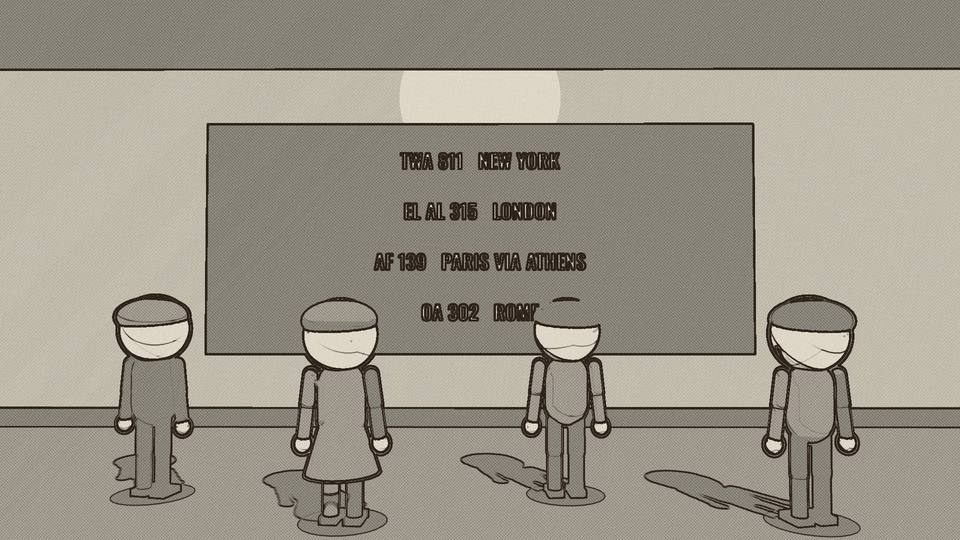

> Air France Flight 139 is going to Paris, with one stop on the way in Athens.

- **Frame:** Departure board flips to "AF 139 PARIS VIA ATHENS"
- **Motion:** push in on the board
- **Sound:** split-flap clatter
- **On-screen text:** BEN GURION · 08:59

### 1.3 · 7.0s
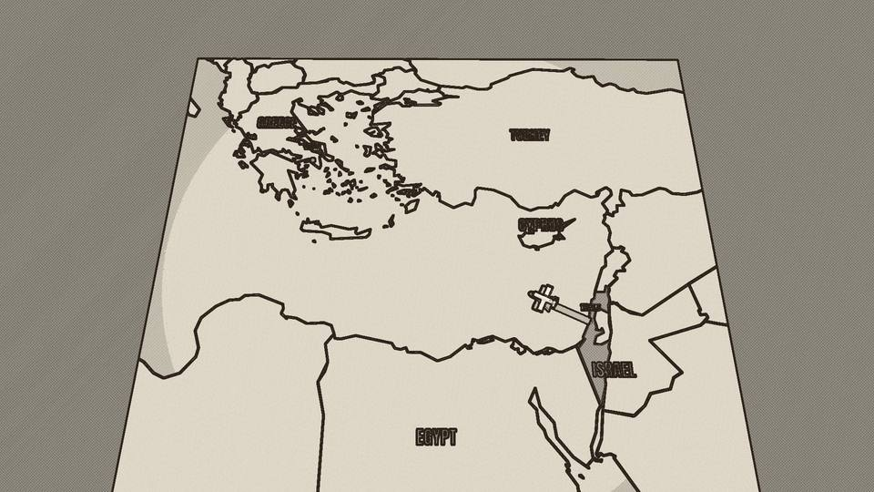

> It leaves on time, just before nine in the morning, and turns west over the Mediterranean.

- **Frame:** Map: Tel Aviv to Athens route ribbon, plane icon travelling
- **Motion:** follow the plane icon
- **Sound:** map swipe, jet whoosh

### 1.4 · 6.2s
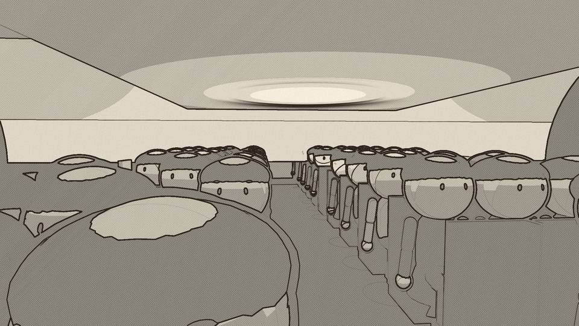

> Most of the passengers are Israeli or Jewish. Families, students, pensioners going on holiday.

- **Frame:** Cabin interior, passengers settling in, a child at the window, an old couple sharing a newspaper
- **Motion:** lateral dolly down the aisle
- **Sound:** cabin ding, chatter murmur
- **On-screen text:** tally: ON BOARD 246

### 1.5 · 6.6s
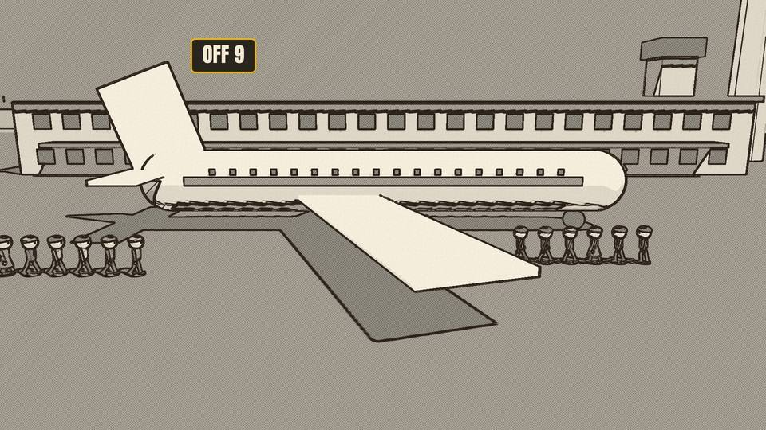

> At half past eleven it lands in Athens. Thirty-eight people get off. Fifty-eight get on.

- **Frame:** Plane at Athens gate, two counters: OFF 38, ON 58
- **Motion:** slow push
- **Sound:** landing thump, tyre squeal
- **On-screen text:** ATHENS · 11:30

### 1.6 · 9.4s
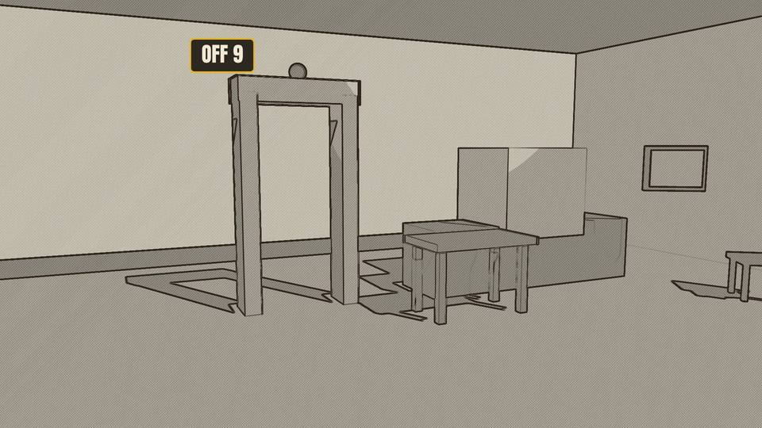

> Athens airport in 1976 is not careful. On this day, a metal detector is broken, and nobody is watching the X-ray screen.

- **Frame:** Security desk: a detector arch with a dead red light, an empty chair in front of the X-ray monitor
- **Motion:** push in on the empty chair
- **Sound:** electrical buzz, fan hum

### 1.7 · 6.6s
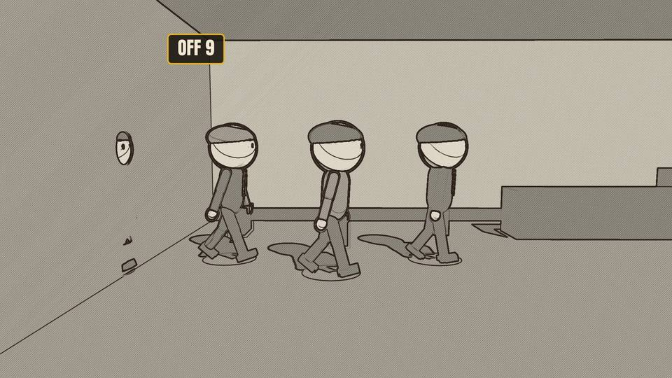

> Four of the new passengers walk straight through with pistols and grenades in their bags.

- **Frame:** Four figures carry bags past the empty X-ray desk; bags glow faintly red in an X-ray tint
- **Motion:** tracking shot alongside them
- **Sound:** footsteps, bag zip

### 1.8 · 7.0s
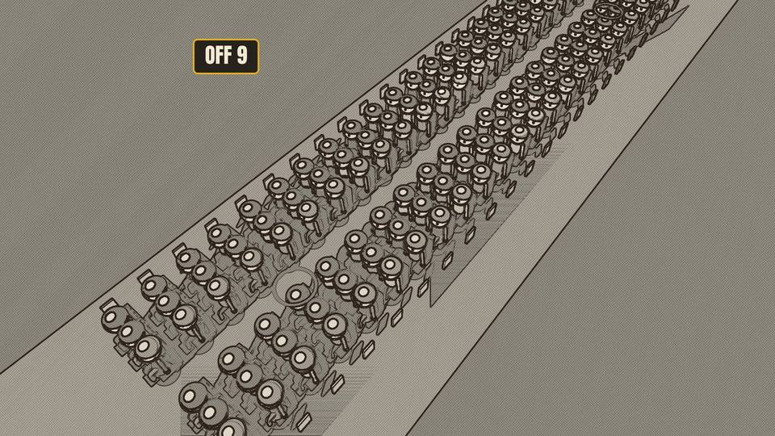

> Two of them sit in first class. Two sit in economy. They look like everyone else.

- **Frame:** Cutaway cabin, two figures highlighted in first class, two in economy
- **Motion:** crane over the cutaway cabin
- **Sound:** soft whoosh, highlight ping

### 1.9 · 5.0s
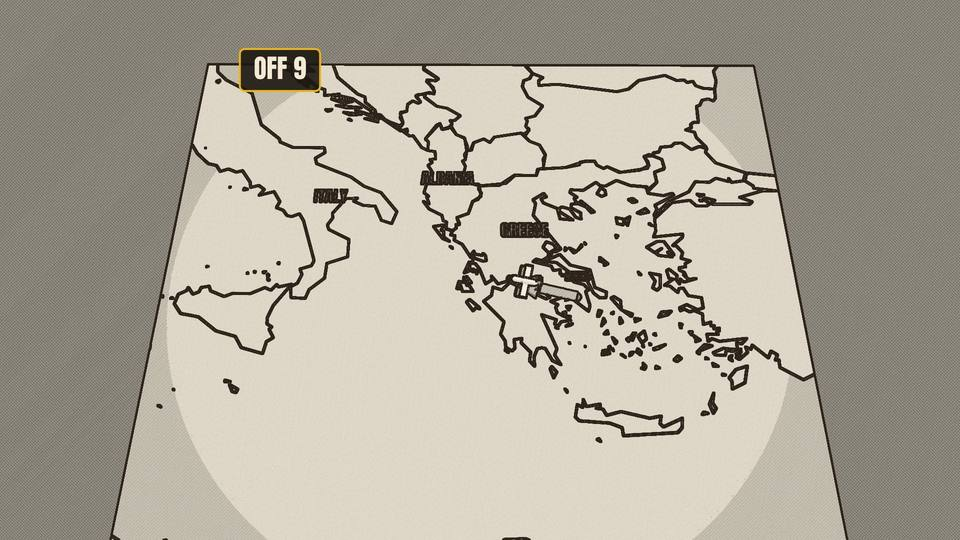

> At ten past twelve, Flight 139 takes off again for Paris.

- **Frame:** Map: route from Athens heading west
- **Motion:** follow the plane icon
- **Sound:** jet whoosh
- **On-screen text:** ATHENS · 12:10

### 1.10 · 11.8s
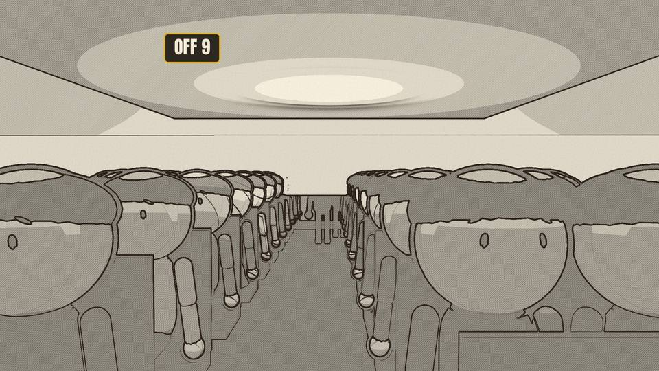

> Eight minutes later, over the Gulf of Corinth, the two in first class stand up. Each has a pistol in one hand and a grenade in the other.

- **Frame:** Silhouettes stand in the first class aisle; weapons shown only as dark shapes, nobody hurt
- **Motion:** slow push from the back of the cabin
- **Sound:** seatbelt click, sharp gasp
- **On-screen text:** 12:18

### 1.11 · 9.4s
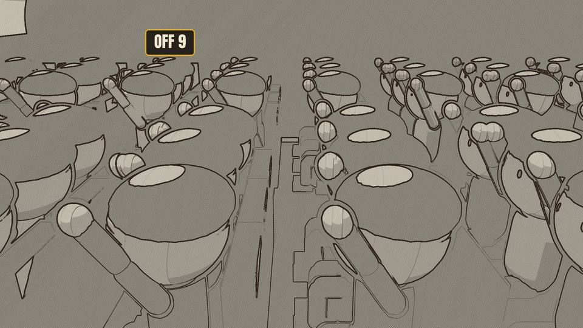

> They run toward the cockpit. The crew and the front rows start screaming. At the back, nobody knows what is happening yet.

- **Frame:** Split frame: panic at the front, calm at the back with a passenger reading
- **Motion:** lateral dolly from front to back
- **Sound:** screams muffled, music drop

### 1.12 · 6.2s
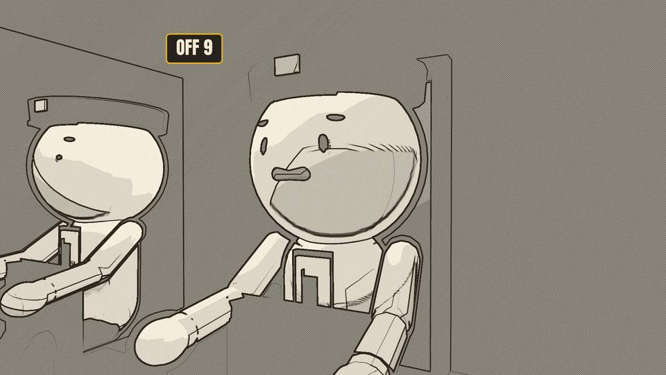

> In the cockpit are the captain, Michel Bacos, the co-pilot, and the flight engineer.

- **Frame:** Cockpit, three crew figures; name callout on the captain
- **Motion:** push in on Bacos
- **Sound:** cockpit beeps, engine hum
- **On-screen text:** callout: MICHEL BACOS / CAPTAIN, AIR FRANCE

### 1.13 · 5.0s
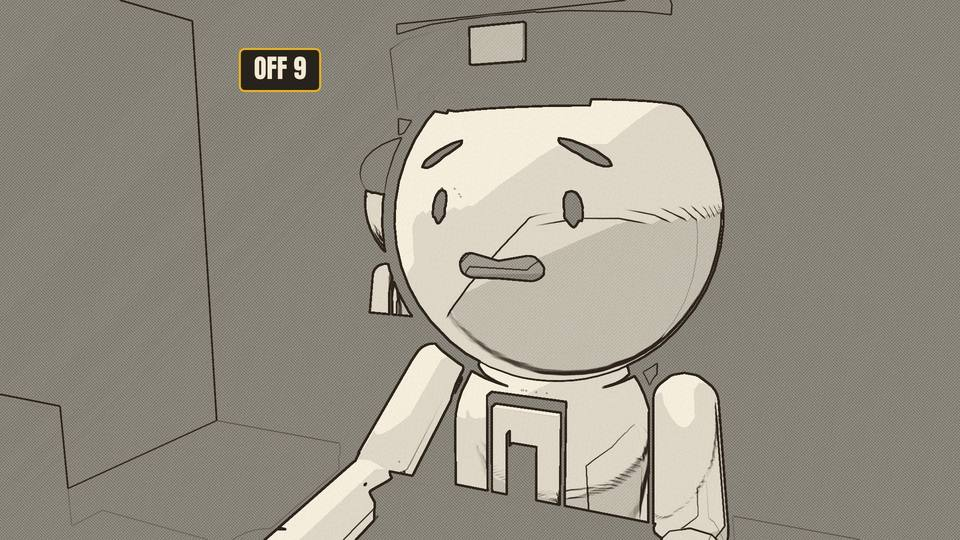

> Bacos hears the screams and sends the engineer out to look.

- **Frame:** Engineer stands, unlatches the cockpit door
- **Motion:** over-the-shoulder from Bacos
- **Sound:** latch click, door creak

### 1.14 · 7.8s
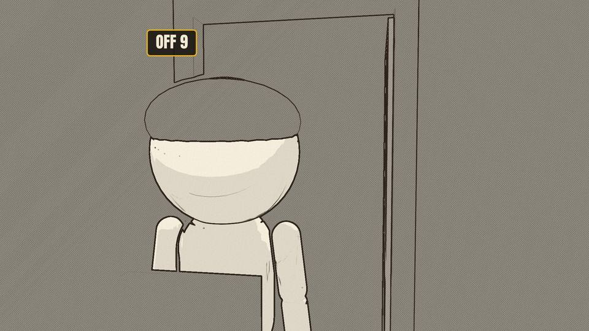

> The door opens, and a man is standing right there, with a gun pointed at the engineer's head.

- **Frame:** Door opens on a silhouette with a raised dark shape; cut before any contact
- **Motion:** quick push, then hold
- **Sound:** door bang, low hit

### 1.15 · 7.0s
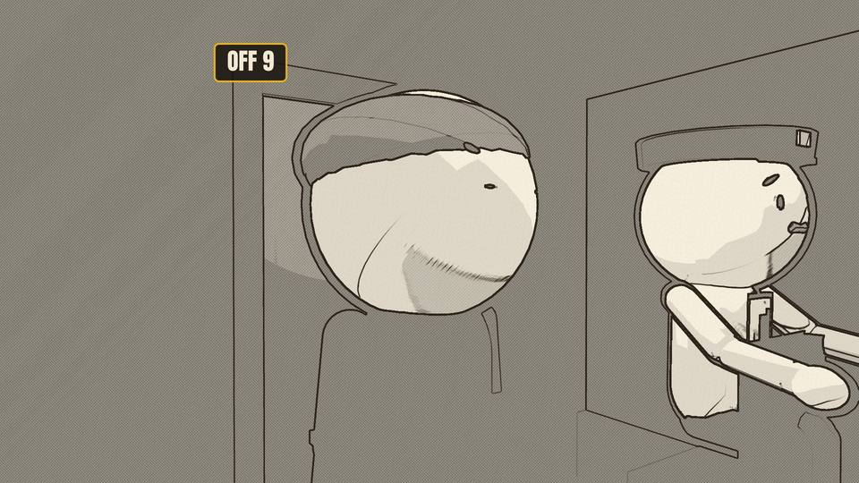

> He is Wilfried Böse, a German. He walks into the cockpit and takes the co-pilot's seat.

- **Frame:** Böse in the co-pilot seat; name callout in red second line
- **Motion:** slow orbit around the seat
- **Sound:** seat creak, low drone
- **On-screen text:** callout: WILFRIED BÖSE / HIJACKER, GERMANY

### 1.16 · 7.0s
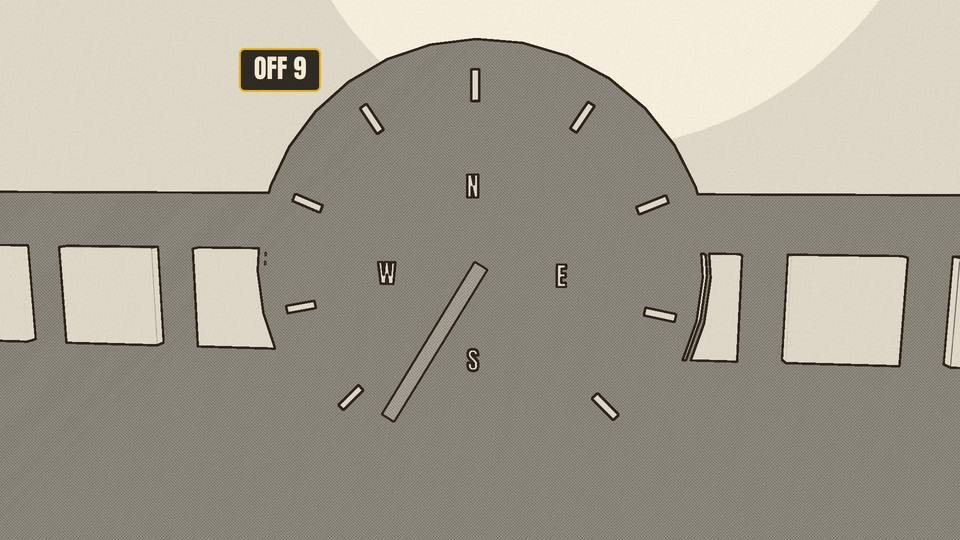

> He tells Bacos to turn the plane south. Do what I say, and nobody gets hurt.

- **Frame:** Böse points at the compass; heading needle swings from west to south
- **Motion:** close on the attitude and heading display
- **Sound:** instrument whir, needle tick

### 1.17 · 8.6s
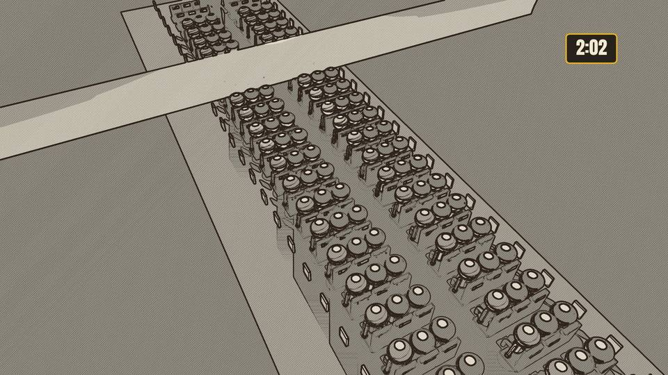

> At the back, the other two hijackers take control of economy. In about three minutes, the whole plane is theirs.

- **Frame:** Two hijackers at the back of economy; a "3:00" stopwatch runs down
- **Motion:** crane over the cabin cutaway
- **Sound:** stopwatch tick, alarm sting

### 1.18 · 11.0s
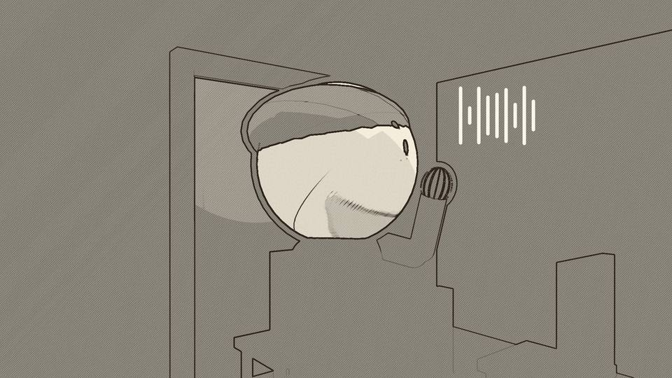

> Then Böse picks up the captain's microphone. He says the plane is hijacked, and that he is the captain now. He says it again in French.

- **Frame:** Böse with the cabin microphone; speech waveform icon over the cabin
- **Motion:** push in on the microphone
- **Sound:** PA crackle, cabin hush
- **On-screen text:** 12:21

### 1.19 · 6.2s
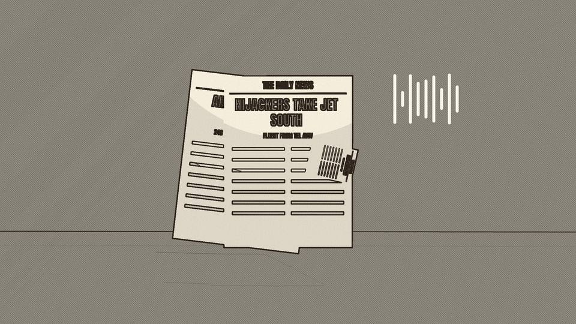

> By the next morning, Flight 139 is on front pages all over the world.

- **Frame:** Newspapers spin in and stack: "AIR FRANCE JET HIJACKED", "246 HOSTAGES"
- **Motion:** newspaper spins, slow push
- **Sound:** paper spin whooshes, press thud

## Act 2 · The Hijackers (27 JUNE 1976)

### 2.1 · 5.0s
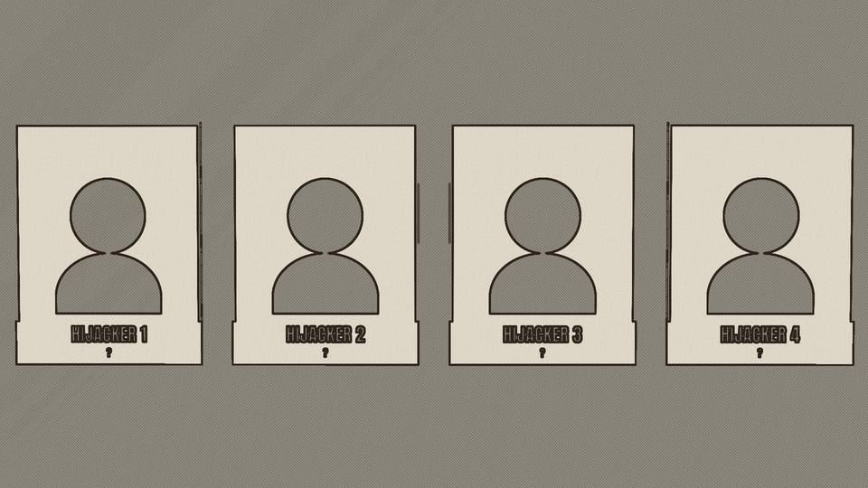

> Meanwhile, the world asks a question. Who are these four people?

- **Frame:** Four silhouette cards flip in a row
- **Motion:** card flips, slow push
- **Sound:** card flips

### 2.2 · 10.2s
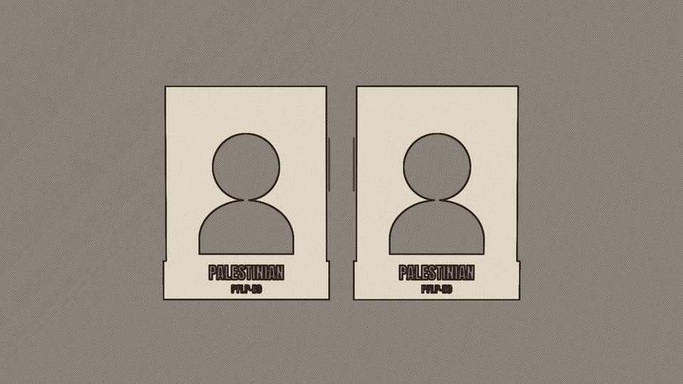

> Two are Palestinian, from a group that split off the Popular Front for the Liberation of Palestine. It is called the PFLP External Operations.

- **Frame:** Two silhouette cards with the group name
- **Motion:** card highlight
- **Sound:** ink stamp
- **On-screen text:** callout: PFLP-EO / PALESTINIAN GROUP

### 2.3 · 7.8s
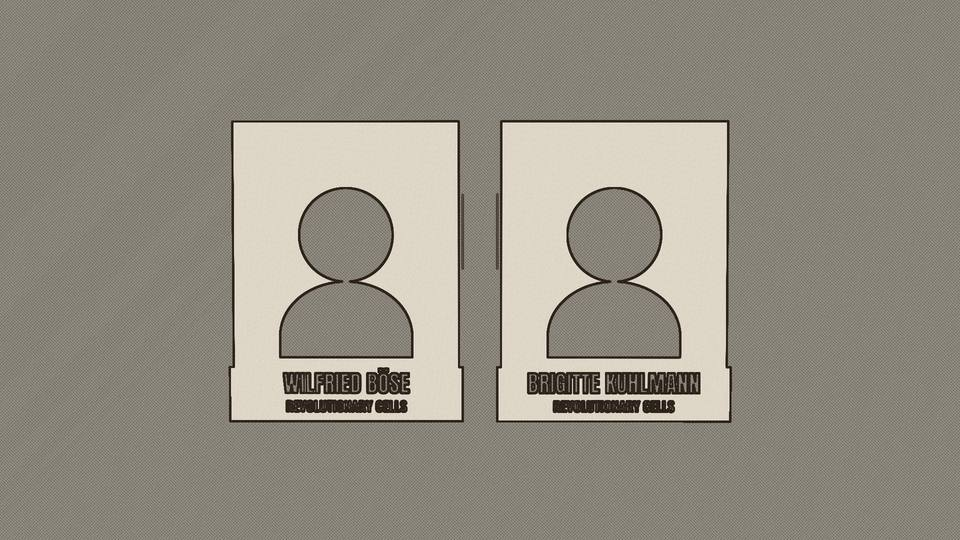

> The other two are German. Wilfried Böse and Brigitte Kuhlmann, from a far-left group called the Revolutionary Cells.

- **Frame:** Böse and Kuhlmann cards, generic house-style figures
- **Motion:** card highlight
- **Sound:** ink stamp
- **On-screen text:** callout: BRIGITTE KUHLMANN / HIJACKER, GERMANY

### 2.4 · 8.6s
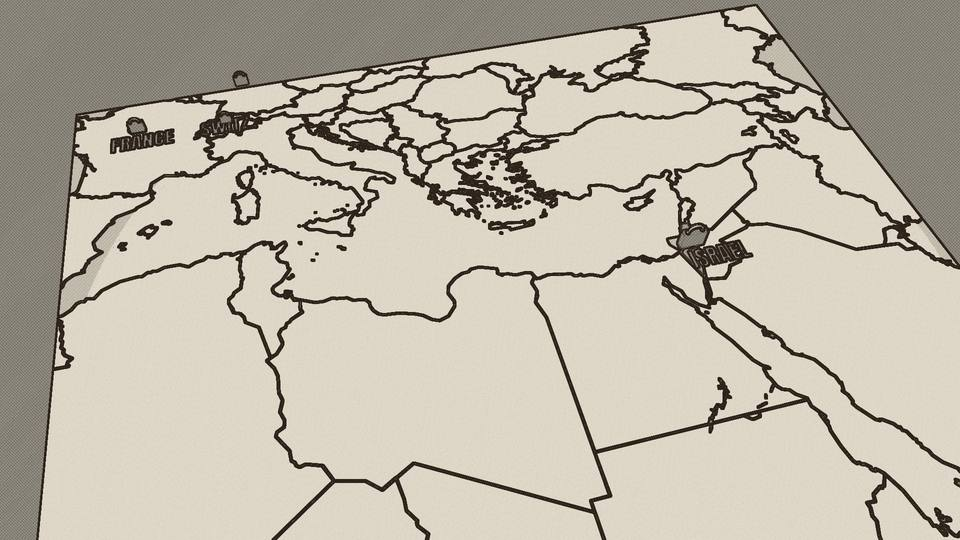

> Many of their comrades are in prison. Most of them in Israel, others in France, West Germany, Switzerland and Kenya.

- **Frame:** Map with prison icons; Israel glows brightest
- **Motion:** camera drifts across Europe, the Middle East and Africa
- **Sound:** padlock clicks

### 2.5 · 7.8s
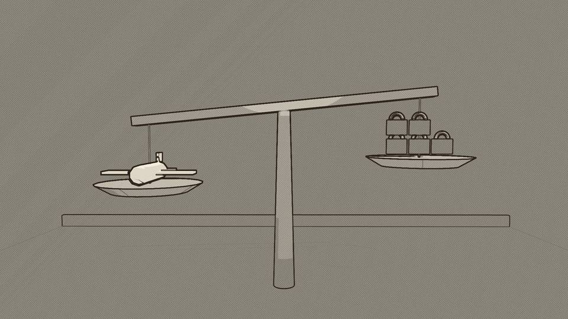

> The plan is simple and cruel. Take a plane full of hostages and trade them for the prisoners.

- **Frame:** Plane icon on one side of a scale, prison padlocks on the other
- **Motion:** scale tips slowly
- **Sound:** scale creak, low boom

### 2.6 · 6.2s
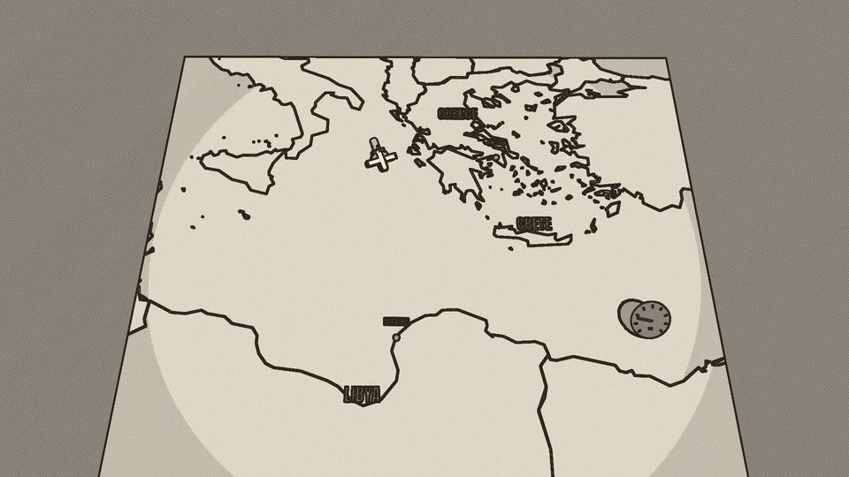

> At three in the afternoon the jet reaches Libya. The fuel is running low.

- **Frame:** Map: plane icon reaching Benghazi; fuel gauge needle near empty
- **Motion:** follow plane, push in on Benghazi
- **Sound:** fuel warning beep
- **On-screen text:** BENGHAZI · 15:00

### 2.7 · 7.4s
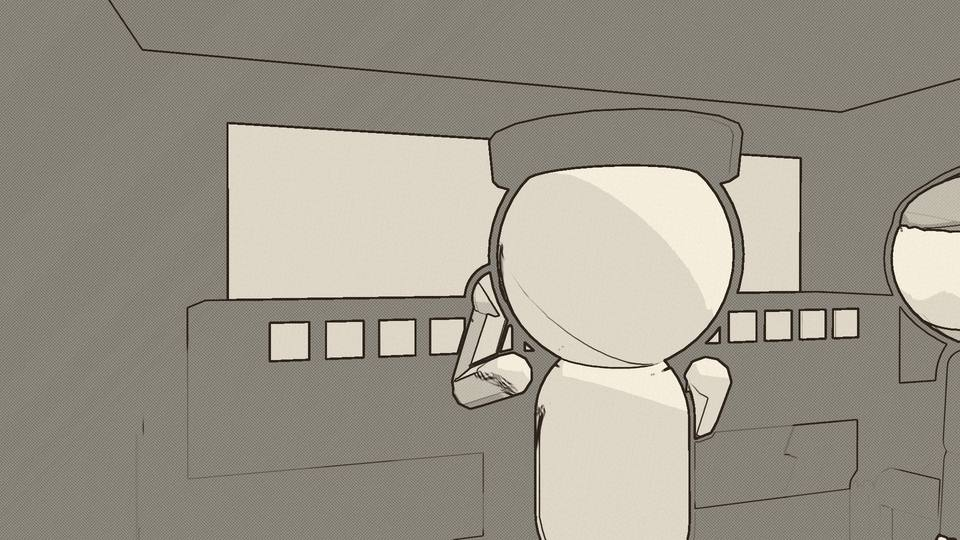

> Bacos tells the control tower in Benghazi it is land here or crash. Libya lets them land.

- **Frame:** Cockpit radio exchange, tower silhouette through the window
- **Motion:** over-the-shoulder at the radio
- **Sound:** radio static, tower voice tone

### 2.8 · 8.2s
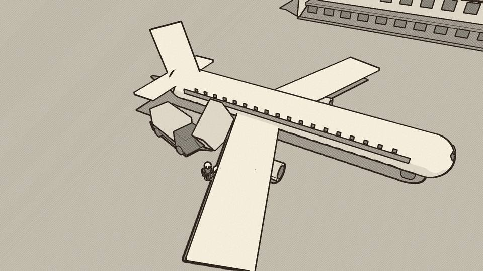

> On the ground, the hijackers relax. They walk off the plane and meet Libyan officials. Passengers are given food.

- **Frame:** Plane on hot tarmac, hijackers chatting with officials, trays passed into the cabin
- **Motion:** wide crane down
- **Sound:** heat shimmer hum, distant chatter

### 2.9 · 13.4s
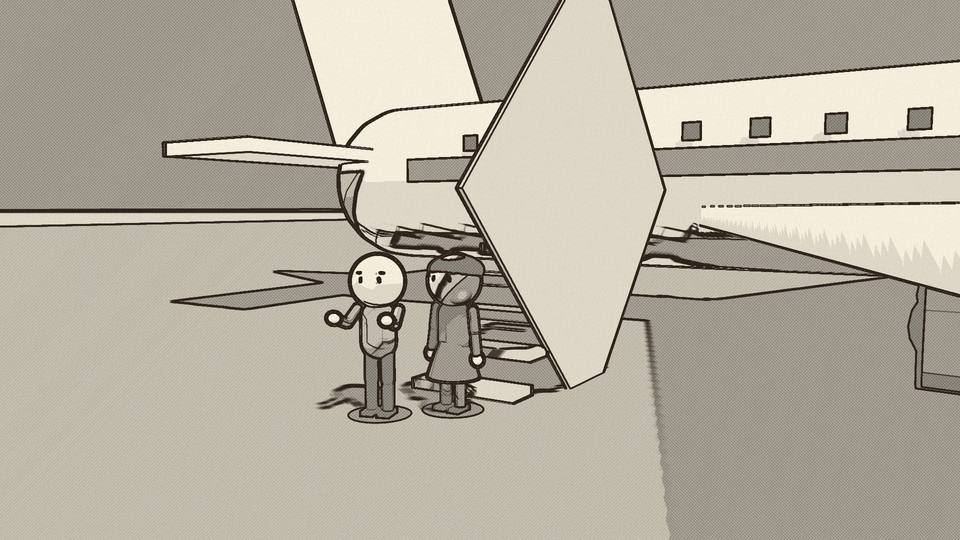

> One passenger, a young woman, tells them she is pregnant and losing her baby. They let her go. She was not really losing the baby. It was a trick, and it worked.

- **Frame:** A woman helped down the stairs; a small "her claim at the time" chip
- **Motion:** slow push
- **Sound:** stairs clank, soft music sting
- **On-screen text:** chip: SHE PRETENDED, SHE WAS RELEASED

### 2.10 · 6.6s
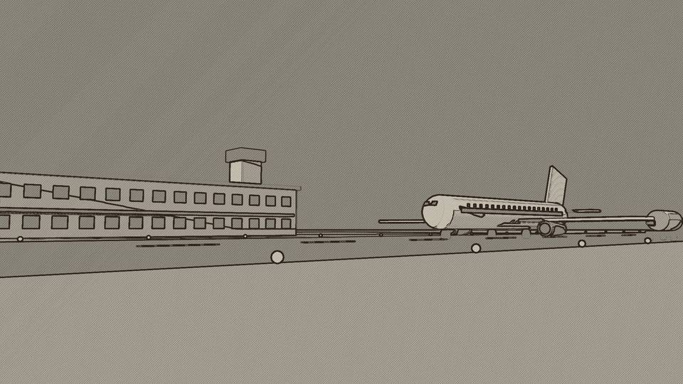

> After about seven hours and a full tank of fuel, the plane takes off again.

- **Frame:** Fuel truck pulls away, jet takes off at dusk
- **Motion:** low angle takeoff
- **Sound:** jet roar

### 2.11 · 5.4s
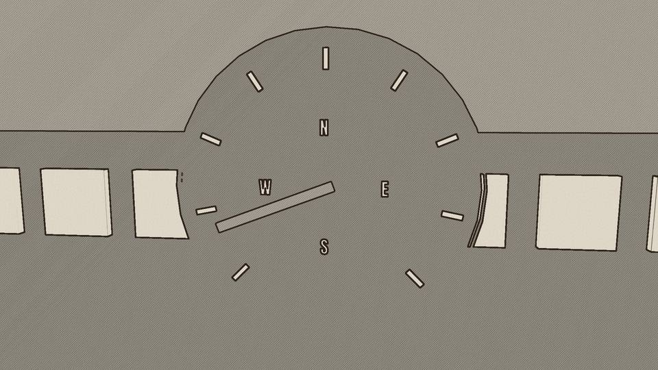

> Soon after takeoff, Böse tells the captain to fly south. To Uganda.

- **Frame:** Heading needle swings south again
- **Motion:** close on the instruments
- **Sound:** needle tick, drone

### 2.12 · 6.6s
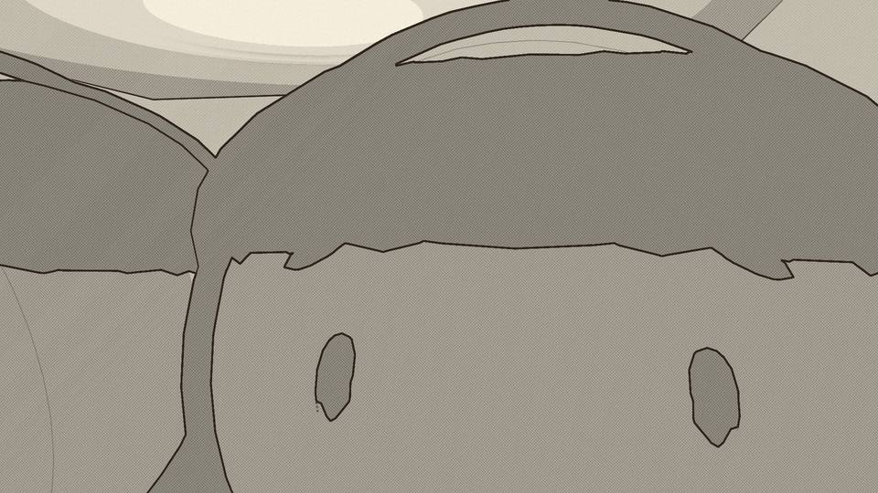

> When the cabin hears the word Uganda, the fear gets worse. Especially for the Israelis.

- **Frame:** Passengers' faces, worried brows, a hand gripping an armrest
- **Motion:** slow lateral dolly
- **Sound:** heartbeat, cabin hush

### 2.13 · 6.6s
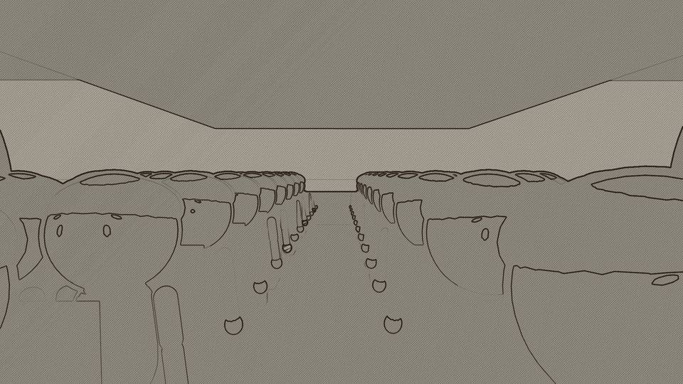

> Nobody knows what will happen next. And not knowing is its own kind of fear.

- **Frame:** Dark cabin, reading lights going off one by one
- **Motion:** slow push down the aisle
- **Sound:** light clicks, low pad

## Act 3 · Idi Amin'S Airport (28 JUNE 1976)

### 3.1 · 4.2s
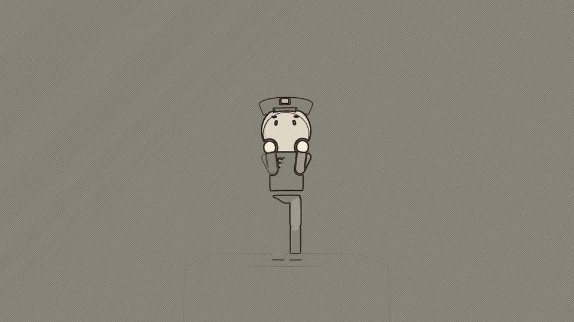

> Meanwhile, Uganda's president is waiting for them. Idi Amin.

- **Frame:** Statue-like portrait of Amin in uniform with medals, lit from below
- **Motion:** slow push up the portrait
- **Sound:** deep drum hit
- **On-screen text:** callout: IDI AMIN / PRESIDENT OF UGANDA

### 3.2 · 9.8s
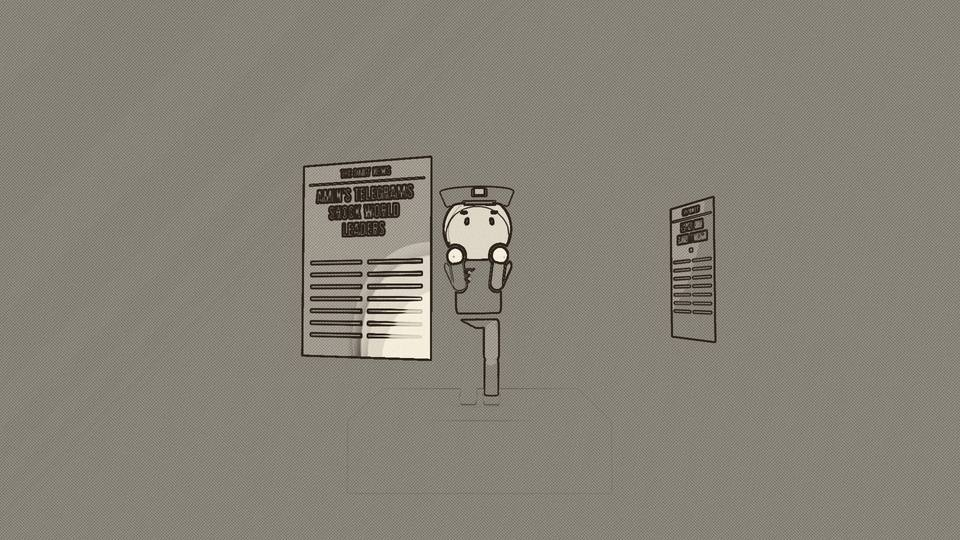

> Amin was famous all over the world, and not for good reasons. He was loud, unpredictable, and he did not follow the rules.

- **Frame:** Newspaper headlines about Amin spin around the portrait
- **Motion:** orbit
- **Sound:** paper whooshes

### 3.3 · 7.4s
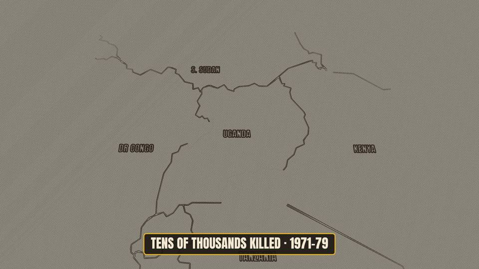

> Since he took power in 1971, tens of thousands of Ugandans had been killed under his rule.

- **Frame:** Dark map of Uganda, a slow counter "TENS OF THOUSANDS"; no bodies shown
- **Motion:** slow sink and desaturate
- **Sound:** low drone, single bell

### 3.4 · 5.8s
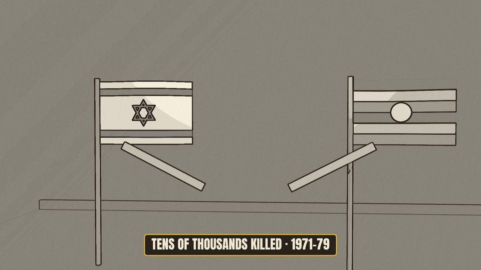

> He had also broken off relations with Israel and turned openly against it.

- **Frame:** Israeli and Ugandan flags; a torn ribbon between them
- **Motion:** push in on the tear
- **Sound:** paper tear

### 3.5 · 8.2s
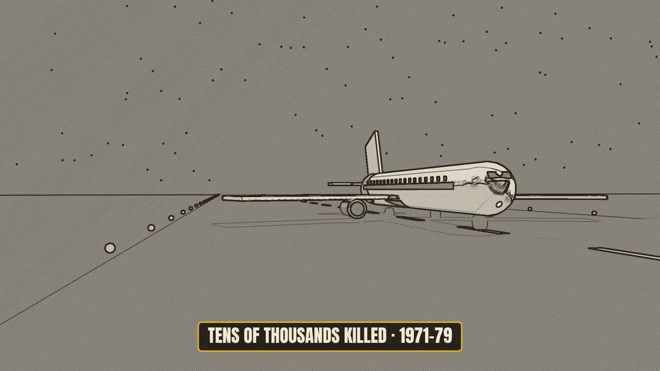

> At about quarter past three in the morning on 28 June, Flight 139 lands at Entebbe, Uganda's main airport.

- **Frame:** Jet lands on a dark runway, landing lights on
- **Motion:** low runway angle
- **Sound:** tyre squeal, reverse thrust
- **On-screen text:** ENTEBBE · 03:15

### 3.6 · 7.8s
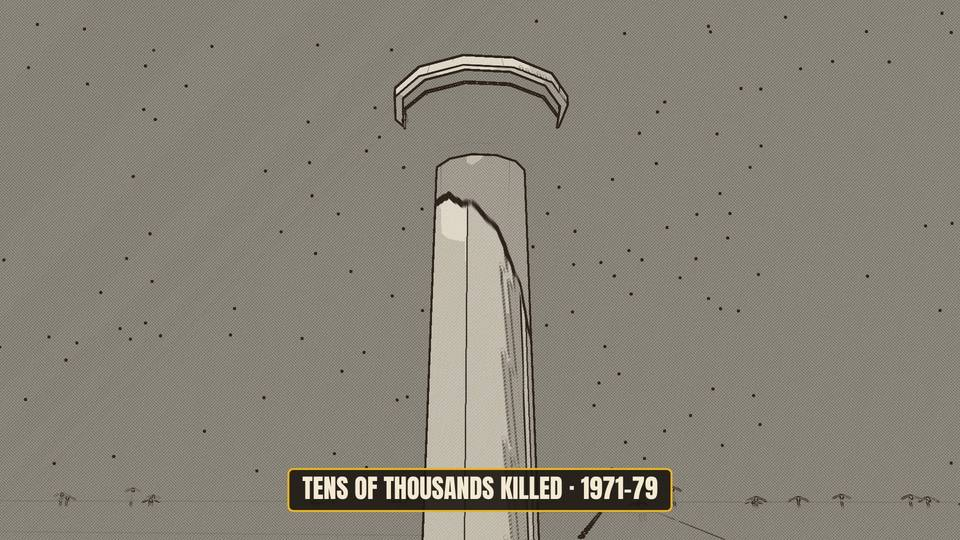

> The control tower lets it land with no argument. Many later asked if Amin knew it was coming.

- **Frame:** Tower with a lit window; chip "never proven"
- **Motion:** slow push on the tower
- **Sound:** radio crackle
- **On-screen text:** chip: SUSPECTED, NEVER PROVEN

### 3.7 · 5.8s
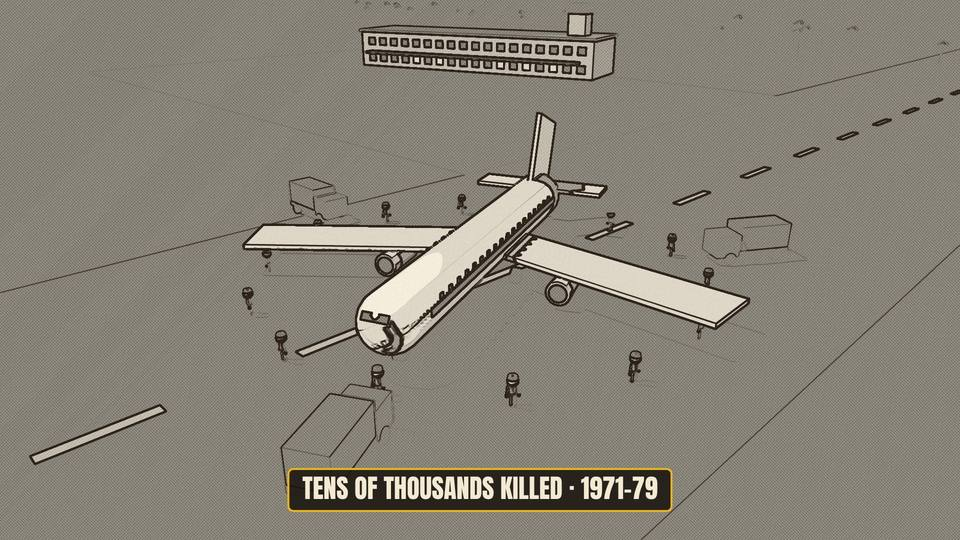

> Ugandan soldiers surround the jet. Trucks, cars and armed men on every side.

- **Frame:** Soldiers and trucks ring the plane in floodlight
- **Motion:** crane up and around
- **Sound:** truck engines, boots

### 3.8 · 7.4s
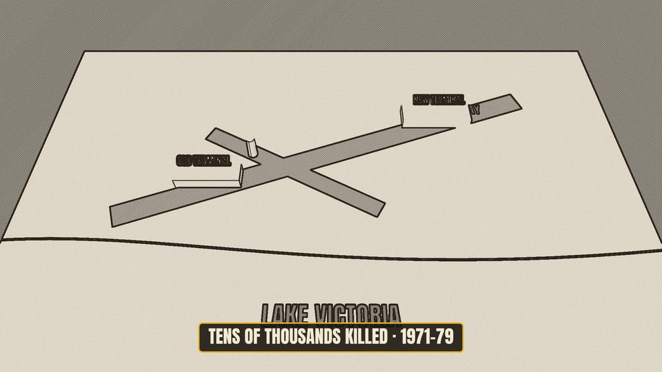

> Entebbe has two terminals. A new one, and an old one that is hardly used any more.

- **Frame:** Airport map: new terminal, old terminal, runways, Lake Victoria to the south
- **Motion:** top-down push in, labels pop
- **Sound:** label pops

### 3.9 · 4.6s
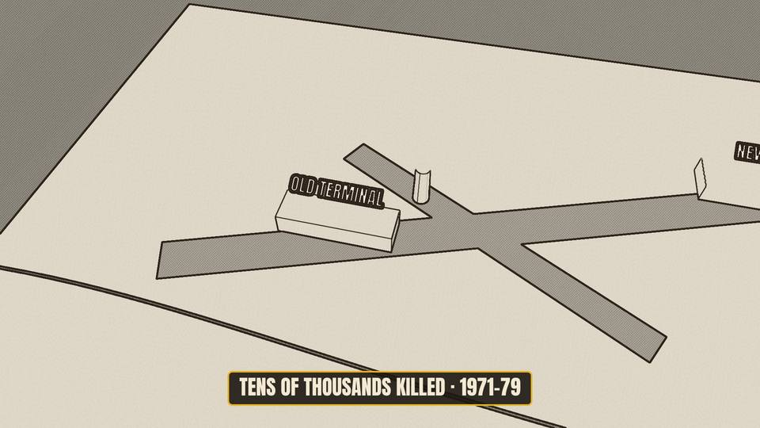

> Remember the old terminal. Everything that happens next happens there.

- **Frame:** Old terminal glows gold on the map
- **Motion:** push in on the old terminal
- **Sound:** soft ding, drone

### 3.10 · 9.8s
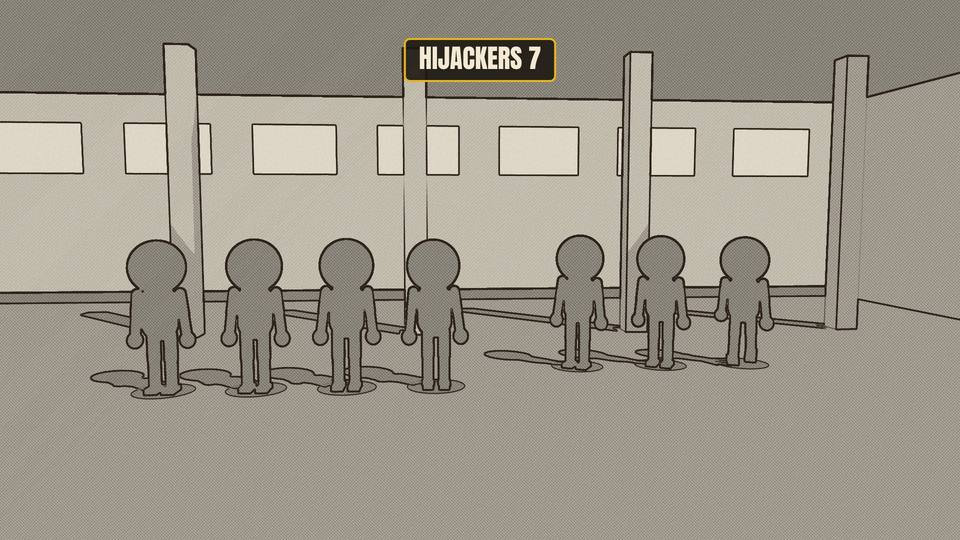

> In the old terminal, the hijackers are joined by more men already waiting in Uganda. There are now at least seven of them.

- **Frame:** Three new silhouettes step out from the shadows; counter 4 to 7
- **Motion:** slow lateral dolly
- **Sound:** footsteps, counter tick
- **On-screen text:** tally: HIJACKERS 7

### 3.11 · 8.2s

> The passengers walk in a line from the plane to the old terminal, between Ugandan soldiers and the hijackers.

- **Frame:** A long line of passengers walking across the apron at dawn, guards on both sides
- **Motion:** tracking shot alongside the line
- **Sound:** footsteps, distant birds
- **On-screen text:** ENTEBBE · 06:00

### 3.12 · 7.4s

> They are put in the main hall. When the hijackers rest upstairs, Ugandan soldiers guard the hostages.

- **Frame:** Hall with mattresses on the floor, soldiers at the doors
- **Motion:** crane down into the hall
- **Sound:** echoing murmur, fan hum

### 3.13 · 9.4s

> Then Idi Amin arrives in person and makes a speech. He says he is only a mediator, trying to keep them safe.

- **Frame:** Amin at the front of the hall, hostages looking up; speech bubble "I am here to help"
- **Motion:** slow push from the back of the hall
- **Sound:** crowd hush, echo

### 3.14 · 6.2s

> The hijackers send their demands. Release fifty-three prisoners, forty of them held in Israel.

- **Frame:** Demand card: "53 PRISONERS · 40 IN ISRAEL"
- **Motion:** card slam
- **Sound:** card slam, typewriter

### 3.15 · 9.0s

> And five million dollars for the plane. The deadline is 1 July. If it passes, they say, the hostages will die.

- **Frame:** Demand card adds "$5,000,000 · DEADLINE 1 JULY"; clock icon
- **Motion:** card slam, clock spins
- **Sound:** cash register, clock tick

## Act 4 · The Selection (29 JUNE TO 1 JULY 1976)

### 4.1 · 4.2s

> Meanwhile, the hijackers start reading names from the passports.

- **Frame:** A hijacker at a table with a stack of passports, reading aloud
- **Motion:** over-the-shoulder at the passports
- **Sound:** paper rustle, echo

### 4.2 · 7.0s

> Israelis and Jewish passengers are moved to a separate room. Even Jewish passengers with other passports.

- **Frame:** Passengers led through a doorway into a second room; the doorway between them
- **Motion:** lateral dolly along the doorway
- **Sound:** footsteps, door scrape
- **On-screen text:** 29 JUNE

### 4.3 · 7.0s

> For many of the older hostages, this moment brings back memories of Europe thirty years earlier.

- **Frame:** An elderly man looks down at his sleeve; soft sepia vignette
- **Motion:** slow push on his face
- **Sound:** low cello-like pad

### 4.4 · 7.0s

> One hostage, seventy-five-year-old Dora Bloch, chokes on food and is taken to a hospital in Kampala.

- **Frame:** An elderly woman helped into a Ugandan ambulance
- **Motion:** slow push
- **Sound:** ambulance door, engine
- **On-screen text:** callout: DORA BLOCH / HOSTAGE, 75

### 4.5 · 5.8s

> Going to hospital will cost her everything. We will come back to her.

- **Frame:** The ambulance drives off into the dark
- **Motion:** camera holds as tail lights fade
- **Sound:** engine fading, single bell

### 4.6 · 9.0s

> On 30 June and 1 July, the hijackers let more than a hundred non-Israeli hostages go. They are flown to Paris.

- **Frame:** Groups of hostages walk to a waiting jet; counters show released numbers
- **Motion:** crane up as they board
- **Sound:** jet engine, crowd
- **On-screen text:** tally: RELEASED 148

### 4.7 · 9.8s

> The hijackers also offer to free the Air France crew. Captain Bacos refuses. His passengers are still here, so his crew stays too.

- **Frame:** Bacos stands in front of his twelve crew members, arms folded
- **Motion:** slow push on Bacos
- **Sound:** music swell, soft thud

### 4.8 · 5.8s

> A hundred and six hostages are left. Ninety-four passengers, and the twelve crew.

- **Frame:** Hall with the remaining hostages; tally card changes
- **Motion:** slow wide push
- **Sound:** tally flip
- **On-screen text:** tally: HOSTAGES 106

### 4.9 · 7.4s

> Releasing those people in Paris looked like mercy. It turned out to be the hijackers' biggest mistake.

- **Frame:** The plane to Paris climbs away; a red X appears on the hijackers' card
- **Motion:** tracking the plane
- **Sound:** jet whoosh, error sting

## Act 5 · The War Room (28 JUNE TO 1 JULY 1976)

### 5.1 · 3.8s

> Meanwhile in Israel, the government has not slept.

- **Frame:** Night in Tel Aviv, a lit government building
- **Motion:** crane down to a window
- **Sound:** city hum, phone rings

### 5.2 · 8.6s

> The army, the Mossad and the Shin Bet meet day and night. Generals, pilots and intelligence officers fill the room.

- **Frame:** War room, figures around a long table with maps and phones
- **Motion:** lateral dolly down the table
- **Sound:** phones ringing, murmur

### 5.3 · 9.4s

> One team has one job. Find out every detail about the place where the hostages are. Every door, every window, every guard.

- **Frame:** An analyst pins photos and drawings to a wall board
- **Motion:** push in on the board
- **Sound:** pins tapping, paper

### 5.4 · 7.4s

> And then the hijackers' mistake pays off. Israeli agents fly to Paris and meet the released hostages.

- **Frame:** Map: line from Tel Aviv to Paris
- **Motion:** follow the line
- **Sound:** map swipe

### 5.5 · 8.6s

> They ask them everything. How many hijackers? Where do the Ugandan soldiers stand? Who sleeps where? Which doors are open?

- **Frame:** Interview room in Paris, a released hostage drawing a sketch of the hall
- **Motion:** over-the-shoulder on the sketch
- **Sound:** pencil scratch

### 5.6 · 10.2s

> At the same time, Israel tries to talk its way out. The United States asks Egypt's president, Anwar Sadat, to put pressure on Amin.

- **Frame:** Phones connect between Washington and Cairo
- **Motion:** split screen phone call
- **Sound:** phone dial, line hum

### 5.7 · 7.0s

> Even the PLO leader, Yasser Arafat, sends an envoy. The hijackers refuse to speak to him.

- **Frame:** An envoy at the terminal door; the door stays shut
- **Motion:** slow push on the shut door
- **Sound:** door knock, silence

### 5.8 · 9.0s

> Israel finds a retired army colonel who knows Amin personally, Baruch Bar-Lev. He calls Amin on the phone again and again.

- **Frame:** Bar-Lev at a desk with a rotary phone; name callout
- **Motion:** push in on the phone
- **Sound:** rotary dial, ring
- **On-screen text:** callout: BARUCH BAR-LEV / RETIRED COLONEL, AMIN'S OLD FRIEND

### 5.9 · 10.6s

> He tells Amin this is his chance to be a hero. Free the hostages, he says, and you might even win the Nobel Peace Prize.

- **Frame:** A golden medal spins in a thought bubble over the phone
- **Motion:** medal spins, slow push
- **Sound:** chime, phone line
- **On-screen text:** chip: BAR-LEV'S ACCOUNT

### 5.10 · 8.2s

> Amin says it is out of his hands. Give them what they want, or they really will kill everyone.

- **Frame:** Amin on the other end of the line, shrugging
- **Motion:** over-the-shoulder on Amin
- **Sound:** line crackle, low boom

### 5.11 · 8.6s

> At home, the pressure grows by the hour. The hostages' families protest outside government offices and push their way inside.

- **Frame:** Crowd with placards outside a government building; some push through the doors
- **Motion:** wide crane over the crowd
- **Sound:** crowd shouts, doors

### 5.12 · 5.8s

> They are on the news every night. Bring them home, whatever it costs.

- **Frame:** TV set showing family members; placard "BRING THEM HOME"
- **Motion:** push in on the TV
- **Sound:** TV static, voice murmur

### 5.13 · 10.2s

> Prime Minister Yitzhak Rabin is ready to negotiate. The hostages are in an enemy country, and he will not risk their lives over prisoners.

- **Frame:** Rabin at the head of the table; name callout
- **Motion:** slow push on Rabin
- **Sound:** clock tick
- **On-screen text:** callout: YITZHAK RABIN / PRIME MINISTER

### 5.14 · 7.8s

> His defence minister, Shimon Peres, disagrees. Free terrorists today, he says, and there will be more hijackings tomorrow.

- **Frame:** Peres stands across the table; name callout
- **Motion:** reverse angle, push
- **Sound:** chair scrape, table thud
- **On-screen text:** callout: SHIMON PERES / DEFENCE MINISTER

### 5.15 · 6.6s

> They agree on one thing. Bring us a military plan, and then we will decide.

- **Frame:** Both men look at an empty map on the table
- **Motion:** crane over the table
- **Sound:** single piano note

## Act 6 · Three Bad Plans (1 TO 3 JULY 1976)

### 6.1 · 6.6s

> On the morning of 1 July, the generals meet at army headquarters in Tel Aviv.

- **Frame:** Kirya headquarters at dawn, cars arriving
- **Motion:** crane down
- **Sound:** car doors, birds
- **On-screen text:** TEL AVIV · 1 JULY

### 6.2 · 3.4s

> Brigadier General Dan Shomron brings three plans.

- **Frame:** Shomron at an easel with three covered boards; name callout
- **Motion:** push in
- **Sound:** paper flip
- **On-screen text:** callout: DAN SHOMRON / BRIGADIER GENERAL

### 6.3 · 7.0s

> Plan one. Navy commandos cross Lake Victoria by boat and storm the terminal from the water.

- **Frame:** Map of Lake Victoria; boat icons cross toward Entebbe
- **Motion:** follow the boats
- **Sound:** water lapping, boat engine

### 6.4 · 5.4s

> One problem nobody had written down. Lake Victoria is full of crocodiles.

- **Frame:** Crocodile eyes rise out of the water next to the boat icons; red X stamps the plan
- **Motion:** push in on the crocodile
- **Sound:** crocodile splash, X stamp

### 6.5 · 4.2s

> Plan two. Drop paratroopers onto the airport at night.

- **Frame:** Parachute icons drift down over the map
- **Motion:** crane following the parachutes
- **Sound:** wind, cloth flutter

### 6.6 · 7.8s

> Plan three. Hide commandos inside a normal passenger plane and land at Entebbe as if nothing was wrong.

- **Frame:** Cutaway civilian jet full of commandos instead of passengers
- **Motion:** slow orbit
- **Sound:** jet hum

### 6.7 · 9.8s

> All three plans get them in. None of them get them out. Every exit depends on Idi Amin helping, and nobody trusts Amin.

- **Frame:** Three boards, each stamped with a red X
- **Motion:** lateral dolly across the boards
- **Sound:** three X stamps

### 6.8 · 6.2s

> Shomron asks for more time to build a plan that needs nothing from Uganda.

- **Frame:** Shomron alone at the table, maps spread out
- **Motion:** slow push
- **Sound:** clock tick

### 6.9 · 10.2s

> So Israel buys that time. It tells the hijackers it accepts their demands, but needs a few days to gather prisoners from five countries.

- **Frame:** Telegram slides across a table: "WE ACCEPT. NEED MORE TIME."
- **Motion:** push in on the telegram
- **Sound:** telegraph clicks

### 6.10 · 11.4s

> Amin likes this. He is about to fly to Mauritius to hand over the chair of the Organisation of African Unity, and a delay suits him too.

- **Frame:** Amin boarding a plane, briefcase in hand
- **Motion:** tracking shot
- **Sound:** jet whoosh

### 6.11 · 6.6s

> The deadline moves to 4 July. Amin goes on the radio and takes the credit.

- **Frame:** Deadline card flips from 1 JULY to 4 JULY; Amin at a microphone
- **Motion:** card flip, push on Amin
- **Sound:** card flip, radio crackle

### 6.12 · 9.4s

> Then the intelligence team finds a gift. An Israeli company, Solel Boneh, built the old terminal at Entebbe in the nineteen seventies.

- **Frame:** Blueprint unrolls on the table, "SOLEL BONEH" in the corner
- **Motion:** push in on the blueprint
- **Sound:** paper unroll

### 6.13 · 5.4s

> Its engineers still have the plans. Every room, every corridor, every door.

- **Frame:** Blueprint lines glow and extrude into a 3D terminal model
- **Motion:** orbit the model as it rises
- **Sound:** build whoosh, soft dings

### 6.14 · 9.4s

> With the blueprints and the Paris interviews, the soldiers build a copy of the terminal and practise the raid again and again.

- **Frame:** Night training: soldiers run through a wood and canvas mock-up
- **Motion:** tracking alongside runners
- **Sound:** boots, whistle

### 6.15 · 11.8s

> The final plan is bold. More than a hundred commandos fly to Uganda without asking anyone. They take the whole airport, free the hostages, and fly them home.

- **Frame:** Animated plan on the map: planes land, teams fan out, planes leave
- **Motion:** top-down plan animation
- **Sound:** whooshes per arrow

### 6.16 · 9.0s

> The plan only works if everything happens fast. Faster than Uganda's army can react. That is why they call it Thunderbolt.

- **Frame:** Lightning bolt emblem flashes across the map
- **Motion:** title flash
- **Sound:** thunder crack

### 6.17 · 7.0s

> On 3 July, the cabinet approves it. By then, the planes are already in the air.

- **Frame:** Clock on the wall; through the window, planes climbing
- **Motion:** push in on the clock
- **Sound:** clock tick, distant engines
- **On-screen text:** 3 JULY 1976

## Act 7 · Four Hercules (3 JULY 1976)

### 7.1 · 8.2s

> Meanwhile, at Entebbe, the hijackers are relaxed. In less than a day, they think, they will have their prisoners.

- **Frame:** Hijackers playing cards upstairs in the terminal
- **Motion:** slow push
- **Sound:** cards shuffling, fan hum

### 7.2 · 4.6s

> Israel picks four C-130 Hercules transport planes for the job.

- **Frame:** Four C-130s lined up on an Israeli airbase at sunset
- **Motion:** lateral dolly along the noses
- **Sound:** engine start whine

### 7.3 · 5.8s

> The Hercules can land on short, rough runways and take off again fast.

- **Frame:** A C-130 does a short landing on a dirt strip, dust cloud
- **Motion:** tracking the landing
- **Sound:** dust whoosh, tyre thud

### 7.4 · 7.4s

> It carries heavy loads, and its back ramp opens so cars and soldiers can roll straight out.

- **Frame:** Cutaway C-130 showing a Mercedes, Land Rovers and soldiers inside
- **Motion:** orbit the cutaway
- **Sound:** hydraulic whine

### 7.5 · 9.0s

> Israel to Entebbe is more than four thousand kilometres. Even full of fuel, the planes cannot make it home without refuelling.

- **Frame:** Map: route with a fuel gauge running down to empty before Israel
- **Motion:** follow the route
- **Sound:** fuel beep

### 7.6 · 6.2s

> So Israel secretly arranges to refuel in Kenya, at Nairobi, on the way back.

- **Frame:** Map: Nairobi glows; secret handshake icon
- **Motion:** push in on Nairobi
- **Sound:** soft ding

### 7.7 · 8.2s

> They also bring a team with portable pumps, ready to steal fuel from Entebbe itself if Kenya says no.

- **Frame:** Ten soldiers with fuel pumps and hoses
- **Motion:** slow push
- **Sound:** metal clanks

### 7.8 · 8.6s

> In the afternoon of 3 July, the four planes take off from Sharm el-Sheikh, at the tip of the Sinai.

- **Frame:** Planes take off one by one over the sea
- **Motion:** low angle takeoffs
- **Sound:** four jet roars
- **On-screen text:** SHARM EL-SHEIKH

### 7.9 · 10.2s

> Two Boeing 707s follow. One is a flying hospital that waits in Nairobi. The other is a flying command post that circles over Entebbe.

- **Frame:** Two 707s high above the C-130s; labels "HOSPITAL" and "COMMAND"
- **Motion:** crane up through the clouds
- **Sound:** jet whooshes, label pops

### 7.10 · 11.4s

> They fly down the Red Sea along the airline routes, then drop very low, just above the waves, below the radars of Egypt, Sudan and Saudi Arabia.

- **Frame:** Map: route ribbon dips; radar circles sweep and miss the planes
- **Motion:** follow ribbon, radar sweeps
- **Sound:** radar pings

### 7.11 · 4.6s

> Over Ethiopia, over Kenya, then across Lake Victoria toward Entebbe.

- **Frame:** Map: ribbon crosses Ethiopia and Kenya to the lake
- **Motion:** crane down to the lake
- **Sound:** wind, drone

### 7.12 · 3.0s

> Each plane has its own job.

- **Frame:** Four plane icons with numbers 1 to 4
- **Motion:** card flips
- **Sound:** card flips

### 7.13 · 7.8s

> Plane one carries the assault team. Twenty-nine commandos from Israel's elite unit, Sayeret Matkal, led by Yoni Netanyahu.

- **Frame:** Cutaway of plane one, the convoy and the 29 men
- **Motion:** push in
- **Sound:** music swell

### 7.14 · 7.8s

> Yoni is the older brother of a man who will one day become Israel's prime minister, Benjamin Netanyahu.

- **Frame:** Two brothers in a family photo frame
- **Motion:** slow push on the frame
- **Sound:** soft pad

### 7.15 · 7.0s

> Plane two carries a team to take the new terminal and hold off the Ugandan army.

- **Frame:** Plane two cutaway, soldiers with flags pointing to the new terminal
- **Motion:** lateral dolly
- **Sound:** drum hit

### 7.16 · 7.4s

> Plane three carries the team that will destroy Uganda's fighter jets, so nobody can chase them home.

- **Frame:** Plane three cutaway, map arrow to the MiG line
- **Motion:** push in
- **Sound:** drum hit

### 7.17 · 4.6s

> Plane four is for the hostages, with doctors on board.

- **Frame:** Plane four with stretchers and a medic
- **Motion:** slow orbit
- **Sound:** soft ding

## Act 8 · The Fake Mercedes (3 TO 4 JULY 1976)

### 8.1 · 5.0s

> One minute before eleven at night, the first Hercules reaches Entebbe.

- **Frame:** Airport map with the lead plane icon approaching from the lake
- **Motion:** top-down push
- **Sound:** engine drone
- **On-screen text:** ENTEBBE · 22:59

### 8.2 · 6.6s

> It comes in with its lights off, two engines shut down to keep it quiet.

- **Frame:** Dark C-130 over the lake, two propellers still
- **Motion:** tracking the plane
- **Sound:** propeller whoosh, wind

### 8.3 · 6.2s

> The ramp opens in the air, so not one second is lost after landing.

- **Frame:** Ramp lowering in flight, soldiers holding on inside
- **Motion:** interior shot looking out the open ramp
- **Sound:** wind roar

### 8.4 · 10.2s

> On the ground, soldiers place battery lights along the runway, so the next planes can land even if Uganda turns the runway lights off.

- **Frame:** Soldiers place small lamps along the runway edge
- **Motion:** lateral dolly along the lamps
- **Sound:** lamp clicks

### 8.5 · 4.6s

> Out comes the black Mercedes and the two Land Rovers.

- **Frame:** Ramp down, convoy rolls out
- **Motion:** low angle
- **Sound:** engine rev, ramp clank
- **On-screen text:** 23:01

### 8.6 · 11.4s

> Amin always arrived at the airport in a black Mercedes with an escort. So the Israelis copied it. Same car, same flags, same kind of number plates.

- **Frame:** Close detail on the flag and plate; side by side with a photo of the real convoy
- **Motion:** push in on the flag
- **Sound:** cloth flutter

### 8.7 · 6.6s

> Then they drive slowly toward the old terminal, at the speed Amin's convoy usually drove.

- **Frame:** Convoy driving through the dark, speedometer 40 km/h
- **Motion:** tracking alongside the convoy
- **Sound:** engine purr

### 8.8 · 8.6s

> But they did not know one thing. A few days earlier, Amin had bought a new Mercedes. A white one.

- **Frame:** Split frame: black Mercedes and white Mercedes; red X on the black one
- **Motion:** push in on the white car
- **Sound:** error sting

### 8.9 · 9.4s

> Three hundred metres from the terminal, two Ugandan sentries see a black Mercedes and know something is wrong. They raise their rifles.

- **Frame:** Two sentries step into the headlights, rifles raised
- **Motion:** slow push from behind the convoy
- **Sound:** music drop, boots

### 8.10 · 11.0s

> The commandos had orders not to fire on Ugandans. But the moment has come. A silenced shot, then a loud one from the Land Rover behind.

- **Frame:** Cut to black on the first shot; a flash lights the dark
- **Motion:** cut to black, flash
- **Sound:** silenced pop, loud crack

### 8.11 · 5.0s

> The loud shot echoes across the runway. The surprise is gone.

- **Frame:** Wide shot of the airport, lights flicking on in windows
- **Motion:** slow crane up
- **Sound:** echo, dogs barking

### 8.12 · 5.0s

> They leave the cars and run the last three hundred metres.

- **Frame:** Silhouettes running toward the terminal
- **Motion:** tracking at running speed
- **Sound:** running boots, breath

### 8.13 · 7.4s

> Soldiers on top of the old control tower open fire. Two teams stay back to fight them.

- **Frame:** Muzzle flashes high on the tower as small star flashes; nobody shown hit
- **Motion:** push in on the tower
- **Sound:** gunfire rattle, distant

### 8.14 · 5.0s

> Yoni's team keeps running toward the main hall. Speed is everything.

- **Frame:** Yoni at the front of the team, silhouette
- **Motion:** tracking close behind
- **Sound:** heartbeat, boots

### 8.15 · 7.8s

> Outside the terminal, Yoni is hit by fire from the Ugandan soldiers. He falls. The others keep going.

- **Frame:** Yoni's silhouette stops; cut to black for one beat
- **Motion:** cut to black
- **Sound:** single shot, silence

### 8.16 · 7.0s

> The man who led the raid is the first to fall. The raid has barely begun.

- **Frame:** The empty spot in the running line, lit by a single lamp
- **Motion:** slow push
- **Sound:** low drone

### 8.17 · 10.6s

> At the door, a hijacker steps out, and he is shot. Inside, two more hijackers turn toward the hostages, and the commandos shoot them first.

- **Frame:** Hall doorway lit by flashes, silhouettes only
- **Motion:** cut between flashes
- **Sound:** gunshots, glass

### 8.18 · 6.2s

> The commandos shout through a megaphone in Hebrew and English. Stay down. Stay down.

- **Frame:** A commando with a megaphone; hostages flat on the mattresses
- **Motion:** low angle from the floor
- **Sound:** megaphone shout, echo

### 8.19 · 7.8s

> One young hostage stands up. In the dark, a commando takes him for a hijacker. He is killed.

- **Frame:** A standing silhouette among the lying hostages; cut to black
- **Motion:** cut to black
- **Sound:** single shot, silence

### 8.20 · 3.0s

> Three hostages die in the crossfire.

- **Frame:** Three candles on black
- **Motion:** slow push
- **Sound:** single bell
- **On-screen text:** tally: HOSTAGES KILLED 3

### 8.21 · 7.4s

> The hostages point to a side room. The last hijackers are hiding there. The commandos go in.

- **Frame:** Door to the side room, a flash under the door
- **Motion:** push in on the door
- **Sound:** grenade thump, gunfire

### 8.22 · 6.2s

> Every hijacker in the terminal is dead. The commandos check every room and floor.

- **Frame:** Corridor with torch beams sweeping
- **Motion:** lateral dolly with the torches
- **Sound:** footsteps, radio crackle
- **On-screen text:** tally: HIJACKERS 0

### 8.23 · 6.2s

> Then the radio call goes out. We have the hostages. We are coming out.

- **Frame:** Commando at a radio, map of the airport behind him
- **Motion:** push in on the radio
- **Sound:** radio click, static

## Act 9 · Home (4 JULY 1976)

### 9.1 · 3.8s

> Meanwhile, the fighting is still going on outside.

- **Frame:** Wide shot of the airport with distant flashes
- **Motion:** slow crane
- **Sound:** distant gunfire

### 9.2 · 6.2s

> The hostages run from the terminal to the planes, with commandos on both sides.

- **Frame:** Line of hostages running across the apron, commandos guarding
- **Motion:** tracking alongside the line
- **Sound:** running feet, engines

### 9.3 · 3.8s

> A hundred and two of them are rescued.

- **Frame:** Counter ticks to 102 as the last hostage boards
- **Motion:** push in on the ramp
- **Sound:** tally ticks, soft ding
- **On-screen text:** tally: RESCUED 102

### 9.4 · 10.2s

> On the military side of the airport, the third team destroys Uganda's fighter jets in a row. Eleven MiGs. Nobody can follow them now.

- **Frame:** Line of MiG jets; flashes roll down the row; smoke only, no people
- **Motion:** lateral dolly down the row
- **Sound:** booms in sequence
- **On-screen text:** tally: MiGs 11

### 9.5 · 7.4s

> In the fighting, around forty-five Ugandan soldiers are killed. Five commandos are wounded. Only one dies. Yoni.

- **Frame:** Memorial card with numbers, no images of bodies
- **Motion:** slow push
- **Sound:** single bell

### 9.6 · 7.0s

> The planes were on the ground for about ninety minutes. The assault itself took around thirty.

- **Frame:** Two clocks: 90 MIN and 30 MIN
- **Motion:** clock slam
- **Sound:** clock ticks, slam

### 9.7 · 4.6s

> They fly to Nairobi, refuel, and head north for home.

- **Frame:** Map: Entebbe to Nairobi to Israel
- **Motion:** follow the route
- **Sound:** jet whoosh

### 9.8 · 7.8s

> On 4 July, they land at Ben Gurion, the same airport the hostages left from eight days earlier.

- **Frame:** Plane lands in morning sun, crowd waiting
- **Motion:** low angle landing
- **Sound:** landing thump, crowd cheer
- **On-screen text:** BEN GURION · 4 JULY

### 9.9 · 5.0s

> Families run onto the tarmac. People cry, sing and hug strangers.

- **Frame:** Crowd hugging at the foot of the ramp
- **Motion:** crane up over the crowd
- **Sound:** cheering, singing

### 9.10 · 7.8s

> In Uganda, Amin is furious. He blames his own army and turns on Kenya, which helped the Israelis.

- **Frame:** Amin at a desk slamming a fist; map of Kenya behind
- **Motion:** push in
- **Sound:** fist slam

### 9.11 · 4.6s

> Hundreds of Kenyans living in Uganda were killed in revenge.

- **Frame:** Dark map of Uganda and Kenya
- **Motion:** slow sink
- **Sound:** low drone

### 9.12 · 6.2s

> And Dora Bloch, the seventy-five-year-old woman taken to hospital, was never seen alive again.

- **Frame:** Empty hospital bed, curtain drawn
- **Motion:** slow push on the curtain
- **Sound:** single bell

### 9.13 · 8.6s

> Years later, British records and a Ugandan inquiry said she was taken from her bed and killed on Amin's orders.

- **Frame:** Document cards: "UK GOVERNMENT FILES", "UGANDA INQUIRY 1987"
- **Motion:** card slides
- **Sound:** paper swipe
- **On-screen text:** chip: BRITISH FILES AND UGANDAN INQUIRY

### 9.14 · 7.4s

> In Israel, Yoni Netanyahu became a national hero. The operation was renamed in his honour. Operation Yonatan.

- **Frame:** Memorial with a flag, title card "OPERATION YONATAN"
- **Motion:** slow push
- **Sound:** soft pad, title slam

### 9.15 · 7.0s

> His younger brother Benjamin carried his name into politics. Twenty years later, he became prime minister.

- **Frame:** Benjamin at a podium, generic house-style figure; date tag 1996
- **Motion:** slow push
- **Sound:** crowd murmur
- **On-screen text:** 1996

### 9.16 · 7.0s

> Almost fifty years on, Entebbe is still called one of the boldest rescue missions ever attempted.

- **Frame:** The four planes fly into sunrise
- **Motion:** slow lateral dolly
- **Sound:** music swell

### 9.17 · 7.0s

> Four planes, four thousand kilometres, in the dark, in a country that wanted them to fail.

- **Frame:** Final wide: the old terminal at dawn, empty
- **Motion:** slow push
- **Sound:** drone fades

### 9.18 · 6.2s

> If you want more stories like this, subscribe. See you in the next one.

- **Frame:** End card with subscribe button
- **Motion:** card slide
- **Sound:** soft ding
